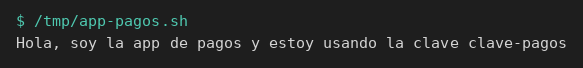
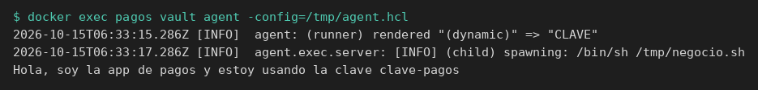

# Integrar una aplicación

[← Página anterior](README.md) · [Siguiente página →](01-lab-consumo-automatico.md)

La aplicación de pagos necesita `clave` y dice en voz alta cuál está usando. Hay dos integraciones. En una, el código de la app llama a la API de Vault. En la otra, ese código no se toca: otro proceso habla con Vault, deja `CLAVE` en el entorno y arranca el de negocio.

## Punto de partida

```bash
bash infra/reiniciar-vault.sh
source infra/entorno.sh
```

`vault-dev` es el servidor, vacío. La terminal queda con `VAULT_ADDR=http://127.0.0.1:8200` y el token `root` de laboratorio. Ese token no entra en la aplicación.

## Recorrido

1. El secreto, la policy de solo lectura y el rol AppRole `pagos` existen antes de la aplicación. Quien vaya a hablar con Vault recibe `role_id` y `secret_id`. La clave se pide después.

```bash
vault kv put secret/pagos/api clave=clave-pagos
bash infra/policy.sh solo-pagos <<'EOF'
path "secret/data/pagos/api" {
  capabilities = ["read"]
}
path "secret/metadata/pagos/api" {
  capabilities = ["read"]
}
path "sys/internal/ui/mounts/secret/*" {
  capabilities = ["read"]
}
EOF
vault auth enable approle
vault write auth/approle/role/pagos token_policies=solo-pagos token_ttl=15m token_max_ttl=1h
ROLE_ID=$(vault read -field=role_id auth/approle/role/pagos/role-id)
SECRET_ID=$(vault write -f -field=secret_id auth/approle/role/pagos/secret-id)
export ROLE_ID SECRET_ID
```

El secreto queda en versión `1`. `ROLE_ID` y `SECRET_ID` quedan en esta terminal.


2. `/tmp/negocio.sh` es el proceso de negocio. Lee la variable `CLAVE` y construye la frase. No tiene dirección de Vault, ni login, ni token. Sin la variable, se detiene.

```bash
cat > /tmp/negocio.sh <<'EOF'
#!/bin/sh
if [ -z "${CLAVE:-}" ]; then
  echo "falta CLAVE" >&2
  exit 1
fi
echo "Hola, soy la app de pagos y estoy usando la clave ${CLAVE}"
EOF
chmod +x /tmp/negocio.sh
/tmp/negocio.sh || true
```

La salida es `falta CLAVE`. El código está listo y todavía no ha hablado con nadie.

3. `/tmp/app-pagos.sh` es la otra integración: el código de la aplicación sí llama a la API. Hace el POST de login, el GET del secreto y usa la clave en la misma frase. El token de AppRole se queda en una variable y no se imprime.

```bash
cat > /tmp/app-pagos.sh <<'EOF'
#!/usr/bin/env bash
set -euo pipefail
login=$(curl -sS --request POST \
  --data "{\"role_id\":\"${ROLE_ID}\",\"secret_id\":\"${SECRET_ID}\"}" \
  "${VAULT_ADDR}/v1/auth/approle/login")
token=$(printf '%s' "$login" | python3 -c 'import json,sys; print(json.load(sys.stdin)["auth"]["client_token"])')
clave=$(curl -sS --header "X-Vault-Token: ${token}" \
  "${VAULT_ADDR}/v1/secret/data/pagos/api" \
  | python3 -c 'import json,sys; print(json.load(sys.stdin)["data"]["data"]["clave"])')
echo "Hola, soy la app de pagos y estoy usando la clave ${clave}"
EOF
chmod +x /tmp/app-pagos.sh
/tmp/app-pagos.sh
```

La línea es `Hola, soy la app de pagos y estoy usando la clave clave-pagos`. Este script es la app modificada para conocer Vault.



4. El inyector hace el mismo login y el mismo GET, y no es el proceso de negocio. Exporta `CLAVE` y lo sustituye con `exec /tmp/negocio.sh`. El fichero del paso 2 no se edita.

```bash
cat > /tmp/inyector.sh <<'EOF'
#!/usr/bin/env bash
set -euo pipefail
login=$(curl -sS --request POST \
  --data "{\"role_id\":\"${ROLE_ID}\",\"secret_id\":\"${SECRET_ID}\"}" \
  "${VAULT_ADDR}/v1/auth/approle/login")
token=$(printf '%s' "$login" | python3 -c 'import json,sys; print(json.load(sys.stdin)["auth"]["client_token"])')
export CLAVE=$(curl -sS --header "X-Vault-Token: ${token}" \
  "${VAULT_ADDR}/v1/secret/data/pagos/api" \
  | python3 -c 'import json,sys; print(json.load(sys.stdin)["data"]["data"]["clave"])')
exec /tmp/negocio.sh
EOF
chmod +x /tmp/inyector.sh
/tmp/inyector.sh
```

La frase es la misma. La escribe `negocio.sh`. El inyector es el papel de un job de CI o de un entrypoint: conecta con Vault y deja el entorno alimentado.


5. Vault Agent es ese entrypoint, hecho con el binario `vault`. Hace falta una máquina distinta de `vault-dev`. El contenedor `pagos` es esa máquina, en la red Docker del servidor. La imagen es `hashicorp/vault` porque trae el cliente `vault`; Agent es `vault agent`. El proceso de negocio no lo usa. `sleep` mantiene el contenedor encendido para poder copiar los ficheros. En un despliegue, el comando del contenedor sería directamente `vault agent`.

```bash
docker rm -f pagos >/dev/null 2>&1 || true
RED=$(docker inspect -f '{{range $k, $v := .NetworkSettings.Networks}}{{$k}}{{"\n"}}{{end}}' vault-dev | head -n 1)
echo "red=$RED"
docker run -d --name pagos --network "$RED" --entrypoint sleep hashicorp/vault:1.18 86400
```

`red=` muestra el nombre de la red, en este laboratorio `infra_default`. Desde `pagos`, `127.0.0.1` es el propio contenedor. Vault se alcanza por el nombre `vault-dev`.

6. Dentro de `pagos` se deja el mismo `negocio.sh` y la configuración de Agent. `env_template "CLAVE"` hace el GET y guarda el valor en la variable. `exec` arranca el proceso cuando la variable ya existe. `restart_on_secret_changes = "never"` vale aquí porque el script termina enseguida; Agent arranca, ejecuta y sale.

```bash
printf '%s' "$ROLE_ID" | docker exec -i pagos tee /tmp/role_id >/dev/null
printf '%s' "$SECRET_ID" | docker exec -i pagos tee /tmp/secret_id >/dev/null
docker exec -i pagos tee /tmp/negocio.sh >/dev/null <<'EOF'
#!/bin/sh
if [ -z "${CLAVE:-}" ]; then
  echo "falta CLAVE" >&2
  exit 1
fi
echo "Hola, soy la app de pagos y estoy usando la clave ${CLAVE}"
EOF
docker exec -i pagos tee /tmp/agent.hcl >/dev/null <<'EOF'
pid_file = "/tmp/vault-agent.pid"

vault {
  address = "http://vault-dev:8200"
}

auto_auth {
  method "approle" {
    config = {
      role_id_file_path = "/tmp/role_id"
      secret_id_file_path = "/tmp/secret_id"
      remove_secret_id_file_after_reading = false
    }
  }
}

env_template "CLAVE" {
  contents = "{{ with secret \"secret/data/pagos/api\" }}{{ .Data.data.clave }}{{ end }}"
}

exec {
  command = ["/bin/sh", "/tmp/negocio.sh"]
  restart_on_secret_changes = "never"
}
EOF
```

Los `tee` terminan sin texto. `negocio.sh` no contiene `VAULT_ADDR` ni `role_id`.

7. Agent arranca, entra, rellena `CLAVE` y hace exec del script. Al terminar el script, Agent termina también. El filtro deja las tres líneas del contrato: la variable renderizada, el proceso arrancado y la frase del negocio.

```bash
docker exec pagos vault agent -config=/tmp/agent.hcl 2>&1 \
  | grep -F -e 'rendered "(dynamic)" => "CLAVE"' -e 'spawning' -e 'Hola, soy'
docker rm -f pagos >/dev/null
```

Aparecen `rendered "(dynamic)" => "CLAVE"`, `(child) spawning: /bin/sh /tmp/negocio.sh` y `Hola, soy la app de pagos y estoy usando la clave clave-pagos`. El contenedor `pagos` desaparece. El servidor `vault-dev` sigue.



## Qué queda visto

La misma frase sale de tres sitios. `app-pagos.sh` lleva la llamada a Vault en su código. `inyector.sh` y Vault Agent llaman ellos, dejan `CLAVE` y ejecutan `negocio.sh` sin editarlo. El [laboratorio](01-lab-consumo-automatico.md) construye los tres otra vez. El job de CI que tiene que fallar con un código concreto está en [el job que falla cerrado](02-lab-job-falla-cerrado.md). Postgres, con un usuario nuevo en cada arranque, está en [la app entra en Postgres](04-lab-credencial-de-postgres.md).
