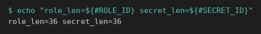
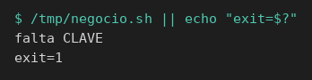
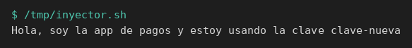

# Consumo automático

[← Página anterior](00-integrar-aplicacion.md) · [Siguiente página →](02-lab-job-falla-cerrado.md)

Vas a dejar el proceso de negocio, que solo lee `CLAVE`, y dos formas de alimentarlo: un script cuyo código llama a la API, y un inyector que exporta la variable y lo ejecuta. Después Vault Agent hace de entrypoint en el contenedor `pagos` y arranca ese mismo proceso.

Cada acción es un comando. El fichero que escribes (el script o `agent.hcl`) va en su propio paso, aparte de los comandos que preparan la máquina.

### Objetivo

`/tmp/negocio.sh` sale con `falta CLAVE`. `/tmp/app-pagos.sh` y `/tmp/inyector.sh` imprimen `Hola, soy la app de pagos y estoy usando la clave clave-pagos`. Agent, al arrancar, escribe esa misma frase.

### Punto de partida

```bash
bash infra/reiniciar-vault.sh
source infra/entorno.sh
```

Servidor vacío. AppRole se habilita en esta página, antes de escribir los scripts. El contenedor `pagos` se crea cuando llegues a la máquina de la app. No reutilices identificadores de otro laboratorio: el reinicio los ha borrado.

### En qué consiste

Preparar el secreto y el rol, comando a comando. Escribir el proceso de negocio y ver que se detiene. Escribir la app que integra la API. Escribir el inyector y ejecutarlo. Preparar la máquina `pagos` y arrancar Agent como entrypoint.

### 1 — Guarda la clave

**Acción:**

```bash
vault kv put secret/pagos/api clave=clave-pagos
```

**Por qué:** este es el valor que la aplicación va a decir en voz alta. Queda en el camino `secret/pagos/api`, versión 1.

**Resultado esperado:** la metadata muestra `version` `1`.

### 2 — Registra la policy de solo lectura

**Acción:**

```bash
bash infra/policy.sh solo-pagos <<'EOF'
path "secret/data/pagos/api" {
  capabilities = ["read"]
}
path "secret/metadata/pagos/api" {
  capabilities = ["read"]
}
path "sys/internal/ui/mounts/secret/*" {
  capabilities = ["read"]
}
EOF
```

**Por qué:** `solo-pagos` es el permiso del token de la app. `secret/data/pagos/api` es el camino real del GET en un KV v2. La línea de `sys/internal/ui/mounts` deja que el CLI de `vault kv` haga su comprobación previa; sin ella el 403 sería de ese preflight.

**Resultado esperado:** `Policy solo-pagos escrita.`

### 3 — Habilita AppRole

**Acción:**

```bash
vault auth enable approle
```

**Por qué:** AppRole es el método con el que entra una aplicación. En el servidor recién reiniciado solo está el método `token`, que es el del `root` de laboratorio.

**Resultado esperado:** `Success! Enabled approle auth method at: approle/`

### 4 — Crea el rol pagos

**Acción:**

```bash
vault write auth/approle/role/pagos \
  token_policies=solo-pagos \
  token_ttl=15m \
  token_max_ttl=1h
```

**Por qué:** el rol ata la policy al login. Quien entre con este rol recibe un token de 15 minutos que solo puede lo que dice `solo-pagos`.

**Resultado esperado:** `Success! Data written to: auth/approle/role/pagos`

### 5 — Guarda el role_id

**Acción:**

```bash
ROLE_ID=$(vault read -field=role_id auth/approle/role/pagos/role-id)
echo "role_len=${#ROLE_ID}"
```

**Por qué:** `role_id` identifica el rol. No es la clave. Lo dejas en una variable de esta terminal para pasárselo a quien vaya a hablar con Vault. El proceso de negocio no lo ve.

**Resultado esperado:** `role_len=36`.

### 6 — Guarda el secret_id

**Acción:**

```bash
SECRET_ID=$(vault write -f -field=secret_id auth/approle/role/pagos/secret-id)
export ROLE_ID SECRET_ID
echo "secret_len=${#SECRET_ID}"
```

**Por qué:** `secret_id` es la credencial que acompaña al `role_id` en el login. `export` hace que los scripts de esta terminal hereden las dos variables. Sin el `export`, el script las vería vacías.

**Resultado esperado:** `secret_len=36`.



### 7 — Escribe el proceso de negocio

**Acción:**

```bash
cat > /tmp/negocio.sh <<'EOF'
#!/bin/sh
if [ -z "${CLAVE:-}" ]; then
  echo "falta CLAVE" >&2
  exit 1
fi
echo "Hola, soy la app de pagos y estoy usando la clave ${CLAVE}"
EOF
```

**Por qué:** este fichero es la app que no se modifica. Si `CLAVE` está vacía, sale 1. Si tiene valor, imprime la frase. No hay `curl`, ni `VAULT_ADDR`, ni `role_id`.

**Resultado esperado:** el comando termina sin imprimir la frase. El fichero ya está en `/tmp/negocio.sh`.

### 8 — Arranca el negocio sin entorno

**Acción:**

```bash
chmod +x /tmp/negocio.sh
/tmp/negocio.sh || echo "exit=$?"
```

**Por qué:** `chmod` lo deja ejecutable para el `exec` del inyector. La ejecución de ahora comprueba el contrato: en esta terminal `CLAVE` no existe, así que el script se detiene y no llama a Vault.

**Resultado esperado:** `falta CLAVE` y `exit=1`.



### 9 — Escribe la app que llama a la API

**Acción:**

```bash
cat > /tmp/app-pagos.sh <<'EOF'
#!/usr/bin/env bash
set -euo pipefail
login=$(curl -sS --request POST \
  --data "{\"role_id\":\"${ROLE_ID}\",\"secret_id\":\"${SECRET_ID}\"}" \
  "${VAULT_ADDR}/v1/auth/approle/login")
token=$(printf '%s' "$login" | python3 -c 'import json,sys; print(json.load(sys.stdin)["auth"]["client_token"])')
clave=$(curl -sS --header "X-Vault-Token: ${token}" \
  "${VAULT_ADDR}/v1/secret/data/pagos/api" \
  | python3 -c 'import json,sys; print(json.load(sys.stdin)["data"]["data"]["clave"])')
echo "Hola, soy la app de pagos y estoy usando la clave ${clave}"
EOF
```

**Por qué:** este es el otro caso. El código de la aplicación lleva el login, se queda el token en una variable y lee la clave. La frase la imprime ella. El token no se imprime.

**Resultado esperado:** el fichero existe. Todavía no ha llamado a Vault.

### 10 — Ejecuta esa app

**Acción:**

```bash
chmod +x /tmp/app-pagos.sh
/tmp/app-pagos.sh
```

**Por qué:** aquí la propia app habla con Vault, usando `ROLE_ID` y `SECRET_ID` de esta terminal.

**Resultado esperado:** `Hola, soy la app de pagos y estoy usando la clave clave-pagos`.


> [!WARNING]
> Si el script falla con `ROLE_ID`, las variables se perdieron al cambiar de terminal. Repite las dos lecturas de `role_id` y `secret_id` y el `export`. No hace falta reescribir los scripts.

### 11 — Escribe el inyector

**Acción:**

```bash
cat > /tmp/inyector.sh <<'EOF'
#!/usr/bin/env bash
set -euo pipefail
login=$(curl -sS --request POST \
  --data "{\"role_id\":\"${ROLE_ID}\",\"secret_id\":\"${SECRET_ID}\"}" \
  "${VAULT_ADDR}/v1/auth/approle/login")
token=$(printf '%s' "$login" | python3 -c 'import json,sys; print(json.load(sys.stdin)["auth"]["client_token"])')
export CLAVE=$(curl -sS --header "X-Vault-Token: ${token}" \
  "${VAULT_ADDR}/v1/secret/data/pagos/api" \
  | python3 -c 'import json,sys; print(json.load(sys.stdin)["data"]["data"]["clave"])')
exec /tmp/negocio.sh
EOF
```

**Por qué:** el inyector no es el negocio. Hace el login, exporta `CLAVE` y `exec` sustituye este proceso por `/tmp/negocio.sh`. El fichero del paso 7 no se edita.

**Resultado esperado:** el fichero existe. Todavía no ha impreso la frase.

### 12 — Ejecuta el inyector

**Acción:**

```bash
chmod +x /tmp/inyector.sh
/tmp/inyector.sh
```

**Por qué:** la frase la escribe `negocio.sh`, con la variable que el inyector acaba de dejar en el entorno.

**Resultado esperado:** `Hola, soy la app de pagos y estoy usando la clave clave-pagos`.


### 13 — Quita un contenedor pagos que haya quedado

**Acción:**

```bash
docker rm -f pagos >/dev/null 2>&1 || true
```

**Por qué:** si un intento anterior dejó el contenedor `pagos`, el nombre está ocupado y el `docker run` fallaría. `rm -f` lo borra si existe. `|| true` hace que la orden siga aunque no hubiera nada que borrar. La redirección esconde el id del contenedor viejo: no lo vas a usar.

**Resultado esperado:** el comando termina. No imprime la clave.

### 14 — Anota la red de Vault

**Acción:**

```bash
RED=$(docker inspect -f '{{range $k, $v := .NetworkSettings.Networks}}{{$k}}{{"\n"}}{{end}}' vault-dev | head -n 1)
echo "red=$RED"
```

**Por qué:** la app tiene que ver al servidor. `docker inspect` lee el nombre de la red en la que ya está `vault-dev` y lo guarda en `RED` para no repetir esa consulta en el `docker run`. En este laboratorio el nombre es `infra_default`.

**Resultado esperado:** `red=infra_default`.

### 15 — Arranca la máquina de la app

**Acción:**

```bash
docker run -d --name pagos --network "$RED" --entrypoint sleep hashicorp/vault:1.18 86400
```

**Por qué:** `pagos` es la máquina de la aplicación, unida a la red que acabas de anotar. La imagen `hashicorp/vault` trae el binario `vault`, que vas a usar como Agent. `--entrypoint sleep` evita que el contenedor arranque otro servidor Vault: `sleep 86400` solo lo mantiene encendido un día, de sobra para copiar ficheros y lanzar Agent. El proceso de negocio no llama a ese binario.

**Resultado esperado:** `docker run` imprime el id del contenedor.

### 16 — Deja el role_id dentro de pagos

**Acción:**

```bash
printf '%s' "$ROLE_ID" | docker exec -i pagos tee /tmp/role_id >/dev/null
```

**Por qué:** Agent no hereda las variables de tu terminal. Este comando copia el `role_id` al fichero `/tmp/role_id` del contenedor, que es de donde lo leerá el login. `tee` escribe el fichero; `>/dev/null` evita volver a imprimir el identificador en pantalla.

**Resultado esperado:** termina sin texto.

### 17 — Deja el secret_id dentro de pagos

**Acción:**

```bash
printf '%s' "$SECRET_ID" | docker exec -i pagos tee /tmp/secret_id >/dev/null
```

**Por qué:** es la otra mitad del login, en `/tmp/secret_id`. Mismo motivo: Agent solo ve ficheros de su máquina.

**Resultado esperado:** termina sin texto.

### 18 — Copia el proceso de negocio

**Acción:**

```bash
docker exec -i pagos tee /tmp/negocio.sh >/dev/null <<'EOF'
#!/bin/sh
if [ -z "${CLAVE:-}" ]; then
  echo "falta CLAVE" >&2
  exit 1
fi
echo "Hola, soy la app de pagos y estoy usando la clave ${CLAVE}"
EOF
```

**Por qué:** dentro de `pagos` ese fichero todavía no existe. Es el mismo script de tu terminal: lee `$CLAVE` y no nombra a Vault.

**Resultado esperado:** termina sin texto.

### 19 — Escribe la config de Agent

**Acción:**

```bash
docker exec -i pagos tee /tmp/agent.hcl >/dev/null <<'EOF'
pid_file = "/tmp/vault-agent.pid"

vault {
  address = "http://vault-dev:8200"
}

auto_auth {
  method "approle" {
    config = {
      role_id_file_path = "/tmp/role_id"
      secret_id_file_path = "/tmp/secret_id"
      remove_secret_id_file_after_reading = false
    }
  }
}

env_template "CLAVE" {
  contents = "{{ with secret \"secret/data/pagos/api\" }}{{ .Data.data.clave }}{{ end }}"
}

exec {
  command = ["/bin/sh", "/tmp/negocio.sh"]
  restart_on_secret_changes = "never"
}
EOF
```

**Por qué:** este fichero es lo único que se le da a Agent. `address` apunta a `vault-dev` porque, dentro de `pagos`, `127.0.0.1` es el propio contenedor. `auto_auth` lee los dos ficheros que acabas de copiar. `env_template` mete la clave en la variable `CLAVE`. `exec` arranca `negocio.sh` cuando esa variable ya existe. `restart_on_secret_changes = "never"` vale aquí porque el script termina enseguida. `remove_secret_id_file_after_reading = false` deja el `secret_id` en disco por si arrancas Agent otra vez en esta página.

**Resultado esperado:** termina sin texto.

### 20 — Arranca Agent

**Acción:**

```bash
docker exec pagos vault agent -config=/tmp/agent.hcl 2>&1 \
  | grep -F -e 'rendered "(dynamic)" => "CLAVE"' -e 'spawning' -e 'Hola, soy'
```

**Por qué:** `vault agent` es el entrypoint del negocio. Entra, renderiza `CLAVE`, hace spawn de `/bin/sh /tmp/negocio.sh` y la frase sale de ese hijo. Cuando el script termina, Agent termina. El `grep` deja esas tres líneas; el resto del log es el arranque del proceso.

**Resultado esperado:** una línea con `rendered "(dynamic)" => "CLAVE"`, otra con `spawning: /bin/sh /tmp/negocio.sh` y `Hola, soy la app de pagos y estoy usando la clave clave-pagos`. El comando vuelve solo, en pocos segundos.


> [!WARNING]
> Al terminar la página, quita la máquina de la app: `docker rm -f pagos`. `bash infra/reiniciar-vault.sh` también la elimina.

## Comprueba tu entendimiento

**El negocio no nombra a Vault**
`grep -E 'VAULT|role_id|curl' /tmp/negocio.sh || echo "el negocio no nombra a Vault"`
→ `el negocio no nombra a Vault`. La llamada está en `app-pagos.sh` y en `inyector.sh`.

**Campo que no existe**
Sustituye el `agent.hcl` de `pagos` por uno que lea `.Data.data.password` y arranca Agent otra vez:

```bash
docker exec -i pagos tee /tmp/agent.hcl >/dev/null <<'EOF'
pid_file = "/tmp/vault-agent.pid"

vault {
  address = "http://vault-dev:8200"
}

auto_auth {
  method "approle" {
    config = {
      role_id_file_path = "/tmp/role_id"
      secret_id_file_path = "/tmp/secret_id"
      remove_secret_id_file_after_reading = false
    }
  }
}

env_template "CLAVE" {
  contents = "{{ with secret \"secret/data/pagos/api\" }}{{ .Data.data.password }}{{ end }}"
}

exec {
  command = ["/bin/sh", "/tmp/negocio.sh"]
  restart_on_secret_changes = "never"
}
EOF
docker exec pagos vault agent -config=/tmp/agent.hcl 2>&1 | grep -F 'Hola, soy'
```

→ La frase termina en `<no value>`. El login ha funcionado y el proceso ha arrancado. El fallo es el nombre del campo.


## Reto

### 1 — El inyector tras una rotación

Escribe la versión 2 con `clave=clave-nueva` y ejecuta otra vez `/tmp/inyector.sh` sin tocar `negocio.sh`.

<details>
<summary>Ver solución</summary>

```bash
vault kv put secret/pagos/api clave=clave-nueva
/tmp/inyector.sh
```

Imprime `Hola, soy la app de pagos y estoy usando la clave clave-nueva`. El proceso de negocio sigue leyendo `$CLAVE`. Quien pide el valor nuevo es el inyector.



</details>

## Errores frecuentes

| Síntoma | Causa probable | Cómo arreglarlo |
|---------|----------------|-----------------|
| `ROLE_ID: unbound variable` | No exportaste los ids en esta terminal | Repite la lectura de `role_id`, la de `secret_id` y el `export` |
| `connection refused` en la salida de Agent | `vault.address` es `127.0.0.1` dentro de `pagos` | Tiene que ser `http://vault-dev:8200` |
| Agent: `permission denied` | El rol no tiene `solo-pagos` o la policy no lleva `secret/data/` | `vault read auth/approle/role/pagos` y `vault policy read solo-pagos` |
| La frase dice `falta CLAVE` al pasar por Agent | Falta `env_template "CLAVE"` o el `exec` | Vuelve a escribir el `agent.hcl` |
| La frase dice `<no value>` | La plantilla no usa `.Data.data.clave` | El `env_template` tiene que leer `.Data.data.clave` |
| `Conflict. The container name "/pagos" is already in use` | Quedó un contenedor del intento anterior | Repite el `docker rm -f pagos` y luego el `docker run` |
