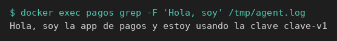
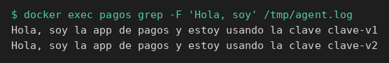

# Agent y el cambio en caliente

[← Página anterior](02-lab-job-falla-cerrado.md) · [Siguiente página →](04-lab-credencial-de-postgres.md)

`negocio.sh` lee `CLAVE` al arrancar. Un proceso que ya está vivo no ve el valor nuevo de una variable. Vault Agent, con el secreto rotado, le manda `SIGTERM` y lo vuelve a ejecutar. El script no se toca. Con un KV v2 el secreto no tiene lease: Agent solo vuelve a leer si el `agent.hcl` le pone un intervalo.

### Objetivo

El log de Agent muestra la frase con `clave-v1` y, tras otra escritura en Vault, una segunda frase con `clave-v2`. Agent sigue siendo el mismo proceso.

### Punto de partida

```bash
bash infra/reiniciar-vault.sh
source infra/entorno.sh
```

Servidor vacío. El contenedor `pagos` se crea en esta página. Quítalo al final: el comando está en el reto y en el aviso de abajo.

### En qué consiste

Preparar el rol, preparar la máquina comando a comando, arrancar Agent, rotar la clave y ver la segunda frase.

### 1 — Guarda la primera clave

**Acción:**

```bash
vault kv put secret/pagos/api clave=clave-v1
```

**Por qué:** es el valor que el proceso va a imprimir en el primer arranque.

**Resultado esperado:** la metadata muestra `version` `1`.

### 2 — Registra la policy

**Acción:**

```bash
bash infra/policy.sh solo-pagos <<'EOF'
path "secret/data/pagos/api" {
  capabilities = ["read"]
}
path "secret/metadata/pagos/api" {
  capabilities = ["read"]
}
path "sys/internal/ui/mounts/secret/*" {
  capabilities = ["read"]
}
EOF
```

**Por qué:** el token de Agent solo podrá leer `secret/data/pagos/api`.

**Resultado esperado:** `Policy solo-pagos escrita.`

### 3 — Habilita AppRole

**Acción:**

```bash
vault auth enable approle
```

**Por qué:** Agent entra con AppRole, no con el token `root`.

**Resultado esperado:** `Success! Enabled approle auth method at: approle/`

### 4 — Crea el rol pagos

**Acción:**

```bash
vault write auth/approle/role/pagos \
  token_policies=solo-pagos \
  token_ttl=15m \
  token_max_ttl=1h
```

**Por qué:** el `secret_id` de este rol no tiene límite de usos. Agent lo lee del fichero y puede volver a autenticarse.

**Resultado esperado:** `Success! Data written to: auth/approle/role/pagos`

### 5 — Guarda los dos identificadores

**Acción:**

```bash
ROLE_ID=$(vault read -field=role_id auth/approle/role/pagos/role-id)
SECRET_ID=$(vault write -f -field=secret_id auth/approle/role/pagos/secret-id)
export ROLE_ID SECRET_ID
echo "role_len=${#ROLE_ID} secret_len=${#SECRET_ID}"
```

**Por qué:** son lo que Agent va a leer de fichero. `export` los deja en esta terminal para los dos `printf` de después. El proceso de negocio no los usa.

**Resultado esperado:** `role_len=36 secret_len=36`.

### 6 — Quita un contenedor pagos anterior

**Acción:**

```bash
docker rm -f pagos >/dev/null 2>&1 || true
```

**Por qué:** libera el nombre `pagos` si quedó de otra página. Si no existía, la orden no falla.

**Resultado esperado:** termina sin imprimir la clave.

### 7 — Anota la red de Vault

**Acción:**

```bash
RED=$(docker inspect -f '{{range $k, $v := .NetworkSettings.Networks}}{{$k}}{{"\n"}}{{end}}' vault-dev | head -n 1)
echo "red=$RED"
```

**Por qué:** guardas en `RED` la red en la que ya está `vault-dev`, para unir ahí la máquina de la app.

**Resultado esperado:** `red=infra_default`.

### 8 — Arranca la máquina de la app

**Acción:**

```bash
docker run -d --name pagos --network "$RED" --entrypoint sleep hashicorp/vault:1.18 86400
```

**Por qué:** el contenedor es la máquina. La imagen trae el binario `vault`. `sleep` la mantiene encendida; no es el proceso de negocio ni un segundo servidor Vault.

**Resultado esperado:** `docker run` imprime un id.

### 9 — Copia el role_id

**Acción:**

```bash
printf '%s' "$ROLE_ID" | docker exec -i pagos tee /tmp/role_id >/dev/null
```

**Por qué:** Agent no ve las variables de tu terminal. El login leerá `/tmp/role_id` dentro de `pagos`.

**Resultado esperado:** termina sin texto.

### 10 — Copia el secret_id

**Acción:**

```bash
printf '%s' "$SECRET_ID" | docker exec -i pagos tee /tmp/secret_id >/dev/null
```

**Por qué:** es la credencial que acompaña al `role_id`, en el otro fichero.

**Resultado esperado:** termina sin texto.

### 11 — Escribe el negocio que se queda vivo

**Acción:**

```bash
docker exec -i pagos tee /tmp/negocio.sh >/dev/null <<'EOF'
#!/bin/sh
if [ -z "${CLAVE:-}" ]; then
  echo "falta CLAVE" >&2
  exit 1
fi
echo "Hola, soy la app de pagos y estoy usando la clave ${CLAVE}"
sleep 3600
EOF
```

**Por qué:** el script imprime la frase y no sale. `sleep 3600` no es la app: evita que el proceso termine antes de la rotación. Un proceso ya vivo no vuelve a leer `CLAVE`; por eso Agent tendrá que pararlo y ejecutarlo otra vez. El código sigue sin nombrar a Vault.

**Resultado esperado:** termina sin texto.

### 12 — Escribe agent.hcl con reinicio

**Acción:**

```bash
docker exec -i pagos tee /tmp/agent.hcl >/dev/null <<'EOF'
pid_file = "/tmp/vault-agent.pid"

vault {
  address = "http://vault-dev:8200"
}

auto_auth {
  method "approle" {
    config = {
      role_id_file_path = "/tmp/role_id"
      secret_id_file_path = "/tmp/secret_id"
      remove_secret_id_file_after_reading = false
    }
  }
}

template_config {
  static_secret_render_interval = "5s"
}

env_template "CLAVE" {
  contents = "{{ with secret \"secret/data/pagos/api\" }}{{ .Data.data.clave }}{{ end }}"
}

exec {
  command = ["/bin/sh", "/tmp/negocio.sh"]
  restart_on_secret_changes = "always"
  restart_stop_signal = "SIGTERM"
}
EOF
```

**Por qué:** un KV v2 vuelve con `lease_duration` 0, así que `static_secret_render_interval` le dice a Agent que vuelva a pedir el secreto cada cinco segundos. `restart_on_secret_changes = "always"` manda `SIGTERM` al hijo y lo ejecuta de nuevo cuando el valor cambia. `address` es `http://vault-dev:8200` porque Agent corre en `pagos`.

**Resultado esperado:** termina sin texto.

### 13 — Arranca Agent en segundo plano

**Acción:**

```bash
docker exec -d pagos sh -c 'vault agent -config=/tmp/agent.hcl > /tmp/agent.log 2>&1'
```

**Por qué:** el hijo no termina, así que Agent no puede ocupar esta terminal. `-d` lo deja corriendo. La salida va a `/tmp/agent.log` porque el proceso principal del contenedor es `sleep` y `docker logs pagos` no muestra a Agent.

**Resultado esperado:** el comando vuelve enseguida. No imprime la frase.

### 14 — Espera la primera frase

**Acción:**

```bash
for _i in 1 2 3 4 5 6 7 8 9 10; do
  docker exec pagos grep -q 'Hola, soy' /tmp/agent.log && break
  sleep 1
done
docker exec pagos grep -F 'Hola, soy' /tmp/agent.log
```

**Por qué:** el bucle mira el log una vez por segundo, hasta diez, y sale en cuanto aparece la frase. El `grep` final te la enseña.

**Resultado esperado:** una línea, `Hola, soy la app de pagos y estoy usando la clave clave-v1`. El bucle no agota los 10 intentos.



### 15 — Escribe la segunda clave

**Acción:**

```bash
vault kv put secret/pagos/api clave=clave-v2
```

**Por qué:** rotas el secreto sin editar `negocio.sh` y sin rearrancar Agent.

**Resultado esperado:** la metadata muestra `version` `2`.

### 16 — Espera el ciclo y lee el log

**Acción:**

```bash
sleep 8
docker exec pagos grep -F 'Hola, soy' /tmp/agent.log
```

**Por qué:** a los cinco segundos Agent vuelve a leer, ve otro valor, manda `SIGTERM` al hijo y lo ejecuta otra vez. Ocho segundos dejan margen para ese ciclo. El proceso nuevo imprime la frase con la variable nueva. La línea vieja se queda en el log.

**Resultado esperado:** dos líneas. La primera sigue en `clave-v1`. La segunda es `Hola, soy la app de pagos y estoy usando la clave clave-v2`.



### 17 — Para Agent

**Acción:**

```bash
docker exec pagos sh -c 'if [ -f /tmp/vault-agent.pid ]; then kill $(cat /tmp/vault-agent.pid) || true; fi'
```

**Por qué:** `pid_file` es el número de proceso que escribió el propio Agent. Lo paras y dejas el contenedor y el log, para poder mirar que ya nadie reescribe la frase.

**Resultado esperado:** el comando termina. No imprime la clave.

> [!WARNING]
> `static_secret_render_interval` hace que Agent siga leyendo el secreto mientras el proceso viva. Al cerrar el ejercicio: `docker rm -f pagos`.

## Comprueba tu entendimiento

**Con Agent parado, el log se queda como está**
`vault kv put secret/pagos/api clave=clave-v3` y, sin esperar, `docker exec pagos grep -F 'Hola, soy' /tmp/agent.log`.
→ Siguen las dos frases, `clave-v1` y `clave-v2`. No aparece `clave-v3`. El contenedor `pagos` tiene que seguir existiendo.

## Reto

### 1 — Vuelve a arrancar Agent y recoge la versión 3

Si hiciste la comprobación, el secreto ya es `clave-v3` y el log no. Arranca Agent otra vez, espera la frase y quita el contenedor.

<details>
<summary>Ver solución</summary>

```bash
docker exec pagos rm -f /tmp/vault-agent.pid
docker exec -d pagos sh -c 'vault agent -config=/tmp/agent.hcl > /tmp/agent.log 2>&1'
for _i in 1 2 3 4 5 6 7 8 9 10; do
  docker exec pagos grep -q 'clave-v3' /tmp/agent.log && break
  sleep 1
done
docker exec pagos grep -F 'Hola, soy' /tmp/agent.log
docker rm -f pagos >/dev/null
```

La frase lleva `clave-v3`. El `>` del log vacía la salida anterior, así que esta ejecución solo muestra el arranque nuevo.

</details>

## Errores frecuentes

| Síntoma | Causa probable | Cómo arreglarlo |
|---------|----------------|-----------------|
| El bucle agota los 10 intentos | Agent no arrancó o la policy no deja leer | `docker exec pagos cat /tmp/agent.log` |
| Tras los 8 segundos sigue una sola línea `clave-v1` | Falta el intervalo, falta `restart_on_secret_changes = "always"`, o no esperaste | Revisa el `agent.hcl` y espera otro ciclo de 8 segundos |
| La frase dice `<no value>` | La plantilla no usa `.Data.data.clave` | Vuelve a escribir el `env_template` |
| `No such container: pagos` en la comprobación | Ya ejecutaste `docker rm -f pagos` | La comprobación va antes de borrar el contenedor |
