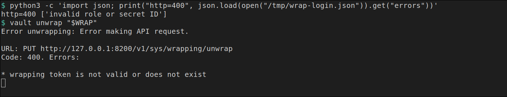
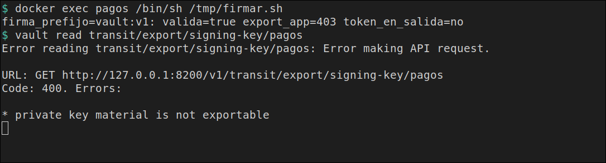

# El secreto no sale por el echo

[← Página anterior](README.md) · [Siguiente página →](01-lab-huella-en-fichero.md)

La aplicación de pagos sigue necesitando la clave. La prueba ya no consiste en oírla. Vault Agent deja el valor en un fichero, el `secret_id` llega envuelto y, cuando la app solo tiene que firmar, la clave privada no sale de Transit.

## Punto de partida

```bash
bash infra/reiniciar-vault.sh
source infra/entorno.sh
```

`vault-dev` queda vacío. La terminal tiene `VAULT_ADDR=http://127.0.0.1:8200` y el token `root` de laboratorio. Ese token no entra en la aplicación.

## Recorrido

1. El secreto, la policy de solo lectura y el rol AppRole `pagos` existen antes de la aplicación. `ROLE_ID` y `SECRET_ID` se quedan en esta terminal. La clave no se imprime.

```bash
vault kv put secret/pagos/api clave=clave-v1
bash infra/policy.sh solo-pagos <<'EOF'
path "secret/data/pagos/api" {
  capabilities = ["read"]
}
path "secret/metadata/pagos/api" {
  capabilities = ["read"]
}
EOF
vault auth enable approle
vault write auth/approle/role/pagos token_policies=solo-pagos token_ttl=15m token_max_ttl=1h
ROLE_ID=$(vault read -field=role_id auth/approle/role/pagos/role-id)
SECRET_ID=$(vault write -f -field=secret_id auth/approle/role/pagos/secret-id)
export ROLE_ID SECRET_ID
echo "role_len=${#ROLE_ID} secret_len=${#SECRET_ID}"
```

La metadata queda en `version` `1`. La última línea es `role_len=36 secret_len=36`.

2. El contenedor `pagos` es la máquina de la aplicación, en la red de `vault-dev`. La imagen trae el binario `vault` para ejecutar Agent. El proceso de negocio es un `sh` que no llama a ese binario para leer la clave: lee un fichero.

```bash
docker rm -f pagos >/dev/null 2>&1 || true
RED=$(docker inspect -f '{{range $k, $v := .NetworkSettings.Networks}}{{$k}}{{"\n"}}{{end}}' vault-dev | head -n 1)
echo "red=$RED"
docker run -d --name pagos --network "$RED" --entrypoint sleep hashicorp/vault:1.18 86400
```

`red=` muestra el nombre de la red, en este laboratorio `infra_default`. Desde `pagos`, Vault se alcanza por `vault-dev`.

3. `/tmp/negocio.sh` exige que `CLAVE` no esté en el entorno, lee `/tmp/clave` y escribe la huella de doce caracteres y el modo del fichero. Si el modo no es `600`, se detiene.

```bash
printf '%s' "$ROLE_ID" | docker exec -i pagos tee /tmp/role_id >/dev/null
printf '%s' "$SECRET_ID" | docker exec -i pagos tee /tmp/secret_id >/dev/null
docker exec -i pagos tee /tmp/negocio.sh >/dev/null <<'EOF'
#!/bin/sh
set -eu
if [ -n "${CLAVE:-}" ]; then
  echo "CLAVE en entorno" >&2
  exit 1
fi
if [ ! -f /tmp/clave ]; then
  echo "falta fichero" >&2
  exit 1
fi
modo=$(stat -c %a /tmp/clave)
if [ "$modo" != "600" ]; then
  echo "modo=${modo}" >&2
  exit 1
fi
huella=$(sha256sum /tmp/clave | awk '{print substr($1,1,12)}')
echo "huella=${huella} modo=${modo} entorno=limpio"
EOF
docker exec pagos chmod +x /tmp/negocio.sh
```

Los `tee` terminan sin texto. El script todavía no tiene fichero que leer.

4. `agent.hcl` autentica con AppRole y renderiza el secreto en `/tmp/clave` con `perms = "0600"`. Un KV v2 no trae lease, así que `static_secret_render_interval` vuelve a leer cada cinco segundos. No hay `env_template` ni `exec`: en esta versión del binario esas dos piezas se excluyen con el `template` de fichero, y el `exec` es el camino que mete el valor en el entorno.

```bash
docker exec -i pagos tee /tmp/agent.hcl >/dev/null <<'EOF'
pid_file = "/tmp/vault-agent.pid"

vault {
  address = "http://vault-dev:8200"
}

auto_auth {
  method "approle" {
    config = {
      role_id_file_path = "/tmp/role_id"
      secret_id_file_path = "/tmp/secret_id"
      remove_secret_id_file_after_reading = false
    }
  }
}

template_config {
  static_secret_render_interval = "5s"
}

template {
  destination = "/tmp/clave"
  perms = "0600"
  contents = "{{ with secret \"secret/data/pagos/api\" }}{{ .Data.data.clave }}{{ end }}"
}
EOF
docker exec -d pagos sh -c 'vault agent -config=/tmp/agent.hcl > /tmp/agent.log 2>&1'
for i in $(seq 1 30); do
  docker exec pagos test -f /tmp/clave && break
  sleep 0.2
done
docker exec pagos /bin/sh /tmp/negocio.sh | tee /tmp/h1.txt
printf '%s' 'clave-v1' | sha256sum | awk '{print "calculada=" substr($1,1,12)}'
```

La salida del script es `huella=1d697ee2f7be modo=600 entorno=limpio`. `calculada=1d697ee2f7be` es la misma huella, obtenida en esta terminal a partir del valor conocido, sin leer `/tmp/clave`. El log de Agent tiene `rendered "(dynamic)" => "/tmp/clave"`.


5. Una segunda escritura cambia el valor. El mismo script, lanzado otra vez cuando Agent ya ha vuelto a renderizar, imprime otra huella. Ni el log ni las dos salidas contienen `clave-v1` ni `clave-v2`.

```bash
vault kv put secret/pagos/api clave=clave-v2 >/dev/null
H1=$(cut -d' ' -f1 /tmp/h1.txt)
for i in $(seq 1 12); do
  docker exec pagos /bin/sh /tmp/negocio.sh > /tmp/h2.txt
  grep -q "$H1" /tmp/h2.txt || break
  sleep 1
done
echo "esperas=$i"
cat /tmp/h2.txt
docker exec pagos cat /tmp/agent.log > /tmp/agent-host.log
if grep -E 'clave-v1|clave-v2' /tmp/h1.txt /tmp/h2.txt /tmp/agent-host.log; then
  echo eco=si
else
  echo eco=no
fi
docker exec pagos sh -c 'kill $(cat /tmp/vault-agent.pid)'
```

`esperas=` es un entero pequeño. La segunda línea es `huella=50b3a5e0f38e modo=600 entorno=limpio`. Después sale `eco=no`.

6. El `secret_id` de la entrega siguiente no se escribe en claro. `-wrap-ttl=3m` devuelve un wrapping token. Esta terminal solo imprime su longitud. Usarlo como `secret_id` en el login responde 400, y el token sigue entero: ese POST no lo abre.

```bash
WRAP=$(vault write -wrap-ttl=3m -field=wrapping_token -f auth/approle/role/pagos/secret-id)
echo "wrap_len=${#WRAP}"
curl -sS -o /tmp/wrap-login.json -w "http=%{http_code}\n" --request POST \
  --data "{\"role_id\":\"${ROLE_ID}\",\"secret_id\":\"${WRAP}\"}" \
  "${VAULT_ADDR}/v1/auth/approle/login"
python3 -c 'import json; print(json.load(open("/tmp/wrap-login.json")).get("errors"))'
```

`wrap_len=95`. Después, `http=400` y `['invalid role or secret ID']`.

7. Agent espera ese token en el fichero del `secret_id` y lo abre porque `secret_id_response_wrapping_path` nombra el camino donde se creó. Al leerlo, borra el fichero. La plantilla escribe `ok` en `/tmp/entrada`: hace falta un `template` para que el auto-auth arranque, y ese fichero no es la clave.

```bash
printf '%s' "$WRAP" | docker exec -i pagos tee /tmp/secret_id >/dev/null
docker exec -i pagos tee /tmp/wrap.hcl >/dev/null <<'EOF'
pid_file = "/tmp/vault-agent.pid"

vault {
  address = "http://vault-dev:8200"
}

auto_auth {
  method "approle" {
    config = {
      role_id_file_path = "/tmp/role_id"
      secret_id_file_path = "/tmp/secret_id"
      remove_secret_id_file_after_reading = true
      secret_id_response_wrapping_path = "auth/approle/role/pagos/secret-id"
    }
  }
}

template {
  destination = "/tmp/entrada"
  contents = "ok"
}
EOF
docker exec -d pagos sh -c 'vault agent -config=/tmp/wrap.hcl > /tmp/wrap.log 2>&1'
for i in $(seq 1 30); do
  docker exec pagos grep -q 'authentication successful' /tmp/wrap.log && break
  sleep 0.2
done
docker exec pagos grep -F 'authentication successful' /tmp/wrap.log
docker exec pagos cat /tmp/entrada
docker exec pagos sh -c 'if [ -f /tmp/secret_id ]; then echo fichero=sigue; else echo fichero=borrado; fi'
vault unwrap "$WRAP" || true
```

El log contiene `authentication successful`. `/tmp/entrada` es `ok`. La línea del fichero es `fichero=borrado`. El unwrap de esta terminal termina en código 2, con `Code: 400` y `wrapping token is not valid or does not exist`. El `secret_id` no llega a imprimirse: el único unwrap que funcionó lo hizo Agent, dentro del proceso.



```bash
docker exec pagos sh -c 'kill $(cat /tmp/vault-agent.pid)'
```

8. La tercera entrega no reparte una clave. Transit crea `pagos` como clave Ed25519. `exportable` queda en `false`. La policy `firma-pagos` solo puede firmar y verificar. El rol `firma` no lee `secret/pagos/api`.

```bash
vault secrets enable transit
vault write -f transit/keys/pagos type=ed25519
bash infra/policy.sh firma-pagos <<'EOF'
path "transit/sign/pagos" {
  capabilities = ["update"]
}
path "transit/verify/pagos" {
  capabilities = ["update"]
}
EOF
vault write auth/approle/role/firma token_policies=firma-pagos token_ttl=15m token_max_ttl=1h
FROLE=$(vault read -field=role_id auth/approle/role/firma/role-id)
FSECRET=$(vault write -f -field=secret_id auth/approle/role/firma/secret-id)
echo "frole_len=${#FROLE} fsecret_len=${#FSECRET}"
```

En la respuesta de la clave aparecen `exportable false`, `supports_signing true` y `type ed25519`. También aparece `public_key`: es la mitad pública. La última línea es `frole_len=36 fsecret_len=36`.

9. Agent escucha en `127.0.0.1:8100` dentro de `pagos` y, con `use_auto_auth_token = true`, añade su token a las peticiones que llegan sin uno. `/tmp/firmar.sh` manda `pago:42`, comprueba la firma y pregunta el export. No escribe el token ni el cuerpo completo de la firma.

```bash
printf '%s' "$FROLE" | docker exec -i pagos tee /tmp/frole >/dev/null
printf '%s' "$FSECRET" | docker exec -i pagos tee /tmp/fsecret >/dev/null
docker exec -i pagos tee /tmp/firmar.sh >/dev/null <<'EOF'
#!/bin/sh
set -eu
IN=$(printf %s 'pago:42' | base64 | tr -d '\n')
resp=$(wget -qO- --header='Content-Type: application/json' \
  --post-data="{\"input\":\"$IN\"}" \
  http://127.0.0.1:8100/v1/transit/sign/pagos)
firma=$(printf %s "$resp" | sed -n 's/.*"signature":"\([^"]*\)".*/\1/p')
case "$firma" in
  vault:v1:*) ;;
  *) echo "firma inesperada" >&2; exit 1 ;;
esac
ver=$(wget -qO- --header='Content-Type: application/json' \
  --post-data="{\"input\":\"$IN\",\"signature\":\"$firma\"}" \
  http://127.0.0.1:8100/v1/transit/verify/pagos)
printf %s "$ver" | grep -q '"valid":true'
codigo=$(wget -S -O /dev/null "http://127.0.0.1:8100/v1/transit/export/signing-key/pagos" 2>&1 | awk '/HTTP\// {print $2; exit}')
if printf %s "$resp$ver" | grep -q 'hvs\.'; then
  echo "token en salida" >&2
  exit 1
fi
echo "firma_prefijo=$(printf %s "$firma" | cut -c1-9) valida=true export_app=${codigo} token_en_salida=no"
EOF
docker exec pagos chmod +x /tmp/firmar.sh
docker exec -i pagos tee /tmp/proxy.hcl >/dev/null <<'EOF'
pid_file = "/tmp/vault-agent.pid"

vault {
  address = "http://vault-dev:8200"
}

auto_auth {
  method "approle" {
    config = {
      role_id_file_path = "/tmp/frole"
      secret_id_file_path = "/tmp/fsecret"
      remove_secret_id_file_after_reading = false
    }
  }
}

listener "tcp" {
  address = "127.0.0.1:8100"
  tls_disable = true
}

api_proxy {
  use_auto_auth_token = true
}
EOF
docker exec -d pagos sh -c 'vault agent -config=/tmp/proxy.hcl > /tmp/proxy.log 2>&1'
for i in $(seq 1 30); do
  docker exec pagos grep -q 'authentication successful' /tmp/proxy.log && break
  sleep 0.2
done
docker exec pagos /bin/sh /tmp/firmar.sh
vault read transit/export/signing-key/pagos || true
docker rm -f pagos >/dev/null
```

La línea de la app es `firma_prefijo=vault:v1: valida=true export_app=403 token_en_salida=no`. El `vault read` del token `root` termina en código 2, con `Code: 400` y `private key material is not exportable`. El contenedor `pagos` desaparece. El log de Agent, si se abre entero, empieza avisando de que el proxy pasa a `vault proxy`; la firma de esta página sale igual.



## Qué queda visto

Tres pruebas, y en ninguna sale el secreto. El fichero da una huella que cambia al rotar. El wrapping token no entra en el login y, después de Agent, ya no se puede abrir. Transit firma `pago:42` y se niega a exportar la clave privada. Cada una se construye sola en [la huella en el fichero](01-lab-huella-en-fichero.md), [secret_id envuelto](02-lab-secret-id-envuelto.md) y [la app firma](03-lab-firma-transit.md). Vault como CA SSH, firmando un certificado de usuario, está en [SSH con Vault como CA](04-lab-ssh-ca.md). Las tres primeras juntas están en [la batería](05-lab-bateria.md).
