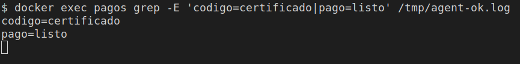
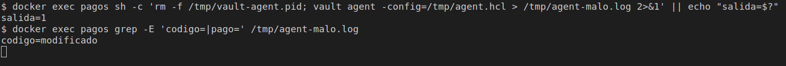
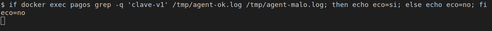

# La huella del código

[← Página anterior](00-secreto-sin-echo.md) · [Siguiente página →](02-lab-secret-id-envuelto.md)

`negocio.sh` no conoce Vault. Si recibe `CLAVE`, trabaja y escribe `pago=listo`. No escribe el valor. Al certificar ese fuente se guarda en Vault la huella del fichero. Vault Agent la vuelve a medir y solo entonces inyecta la clave y arranca el proceso. Si alguien añade un `echo` de la clave, la huella ya no coincide: Agent termina con código 1 y `negocio.sh` no llega a ejecutarse.

### Objetivo

Con el fuente certificado, el log muestra `codigo=certificado` y `pago=listo`. Tras añadir `echo "$CLAVE"`, la huella medida pasa a `aa264905fb45`, el log muestra `codigo=modificado`, Agent sale con código 1 y `clave-v1` no aparece.

### Punto de partida

```bash
bash infra/reiniciar-vault.sh
source infra/entorno.sh
```

Servidor vacío. El contenedor `pagos` se crea en esta página. Quítalo al final: el comando está en el último paso.

### En qué consiste

Preparar el rol, registrar la huella del fuente y dejar que Agent ejecute la comprobación, primero con el código certificado y después con el código modificado.

### 1 — Guarda la clave

**Acción:**

```bash
vault kv put secret/pagos/api clave=clave-v1
```

**Por qué:** es el valor que Agent inyectará en el proceso. En esta página no tiene que salir escrito en ningún log.

**Resultado esperado:** la metadata muestra `version` `1`.

### 2 — Registra la policy

**Acción:**

```bash
bash infra/policy.sh solo-pagos <<'EOF'
path "secret/data/pagos/api" {
  capabilities = ["read"]
}
path "secret/data/pagos/codigo" {
  capabilities = ["read"]
}
EOF
```

**Por qué:** el token de Agent puede leer la clave y la huella registrada. No puede escribir ninguna de las dos.

**Resultado esperado:** `Policy solo-pagos escrita.`

### 3 — Habilita AppRole y crea el rol

**Acción:**

```bash
vault auth enable approle
vault write auth/approle/role/pagos \
  token_policies=solo-pagos \
  token_ttl=15m \
  token_max_ttl=1h
```

**Por qué:** Agent entra con AppRole. El token `root` se queda en tu terminal.

**Resultado esperado:** `Success! Enabled approle auth method at: approle/` y `Success! Data written to: auth/approle/role/pagos`.

### 4 — Guarda los dos identificadores

**Acción:**

```bash
ROLE_ID=$(vault read -field=role_id auth/approle/role/pagos/role-id)
SECRET_ID=$(vault write -f -field=secret_id auth/approle/role/pagos/secret-id)
export ROLE_ID SECRET_ID
echo "role_len=${#ROLE_ID} secret_len=${#SECRET_ID}"
```

**Por qué:** Agent los lee de fichero dentro de `pagos`. Esta línea confirma que los tienes, sin volver a imprimirlos.

**Resultado esperado:** `role_len=36 secret_len=36`.

### 5 — Crea la máquina de la aplicación

**Acción:**

```bash
docker rm -f pagos >/dev/null 2>&1 || true
RED=$(docker inspect -f '{{range $k, $v := .NetworkSettings.Networks}}{{$k}}{{"\n"}}{{end}}' vault-dev | head -n 1)
echo "red=$RED"
docker run -d --name pagos --network "$RED" --entrypoint sleep hashicorp/vault:1.18 86400
```

**Por qué:** Agent corre al lado de la app, en la red de `vault-dev`. `sleep` mantiene el contenedor encendido mientras se copian los ficheros. Desde dentro, `127.0.0.1` es el propio contenedor.

**Resultado esperado:** `red=infra_default` y un identificador de contenedor.

### 6 — Escribe el proceso de negocio

**Acción:**

```bash
printf '%s' "$ROLE_ID" | docker exec -i pagos tee /tmp/role_id >/dev/null
printf '%s' "$SECRET_ID" | docker exec -i pagos tee /tmp/secret_id >/dev/null
docker exec -i pagos tee /tmp/negocio.sh >/dev/null <<'EOF'
#!/bin/sh
set -eu
if [ -z "${CLAVE:-}" ]; then
  echo "falta CLAVE" >&2
  exit 1
fi
echo "pago=listo"
EOF
docker exec pagos chmod +x /tmp/negocio.sh
```

**Por qué:** este fichero es el que se certifica. Exige la clave y no la imprime. No nombra a Vault. La huella del paso siguiente sale de estos bytes: si añades un espacio o una línea, deja de ser `b1501cb434fd`.

**Resultado esperado:** los comandos terminan sin texto.

### 7 — Registra la huella

**Acción:**

```bash
HUELLA=$(docker exec pagos sha256sum /tmp/negocio.sh | awk '{print substr($1,1,12)}')
vault kv put secret/pagos/codigo huella="$HUELLA"
echo "huella=${HUELLA}"
```

**Por qué:** la certificación queda en Vault, en `secret/pagos/codigo`. Agent leerá este valor y lo comparará con el fichero que haya en la máquina en el momento de arrancar. Cambiar `negocio.sh` después no actualiza esta huella.

**Resultado esperado:** la metadata muestra `version` `1`. La última línea es `huella=b1501cb434fd`.

### 8 — Escribe la comprobación que ejecuta Agent

**Acción:**

```bash
docker exec -i pagos tee /tmp/validar.sh >/dev/null <<'EOF'
#!/bin/sh
set -eu
medida=$(sha256sum /tmp/negocio.sh | awk '{print substr($1,1,12)}')
if [ "$medida" != "${HUELLA:-}" ]; then
  echo "codigo=modificado" >&2
  exit 1
fi
echo "codigo=certificado"
exec /bin/sh /tmp/negocio.sh
EOF
docker exec pagos chmod +x /tmp/validar.sh
```

**Por qué:** `validar.sh` es el proceso que arranca Agent, no el de negocio. Mide `/tmp/negocio.sh`. Si la huella coincide, `exec` lo sustituye por el proceso de negocio, que hereda `CLAVE`. Si no coincide, termina aquí: `negocio.sh` no arranca y no ve la clave. Este script no imprime `CLAVE` ni `HUELLA`.

**Resultado esperado:** los comandos terminan sin texto.

### 9 — Escribe la configuración de Agent

**Acción:**

```bash
docker exec -i pagos tee /tmp/agent.hcl >/dev/null <<'EOF'
pid_file = "/tmp/vault-agent.pid"

vault {
  address = "http://vault-dev:8200"
}

auto_auth {
  method "approle" {
    config = {
      role_id_file_path = "/tmp/role_id"
      secret_id_file_path = "/tmp/secret_id"
      remove_secret_id_file_after_reading = false
    }
  }
}

env_template "CLAVE" {
  contents = "{{ with secret \"secret/data/pagos/api\" }}{{ .Data.data.clave }}{{ end }}"
}

env_template "HUELLA" {
  contents = "{{ with secret \"secret/data/pagos/codigo\" }}{{ .Data.data.huella }}{{ end }}"
}

exec {
  command = ["/bin/sh", "/tmp/validar.sh"]
  restart_on_secret_changes = "never"
}
EOF
```

**Por qué:** `CLAVE` es el secreto y `HUELLA` es la huella registrada. Las dos llegan al entorno de `validar.sh`. `exec` arranca esa comprobación, no `negocio.sh`. `restart_on_secret_changes = "never"` deja que esta página lance Agent, espere a que termine y lo vuelva a lanzar a mano cuando el fuente cambie. `remove_secret_id_file_after_reading = false` conserva el `secret_id` para ese segundo arranque.

**Resultado esperado:** termina sin texto.

### 10 — Arranca Agent con el código certificado

**Acción:**

```bash
docker exec pagos sh -c 'rm -f /tmp/vault-agent.pid; vault agent -config=/tmp/agent.hcl > /tmp/agent-ok.log 2>&1'
docker exec pagos grep -E 'codigo=certificado|pago=listo' /tmp/agent-ok.log
```

**Por qué:** Agent entra, renderiza las dos variables y arranca `validar.sh`. La huella coincide, así que el proceso de negocio hereda `CLAVE` y escribe `pago=listo`. El log nombra las variables (`rendered "(dynamic)" => "CLAVE"`) y no escribe el valor.

**Resultado esperado:** el primer comando termina en 0. Después salen dos líneas:

```text
codigo=certificado
pago=listo
```



### 11 — Modifica el fuente para leer la clave

**Acción:**

```bash
docker exec pagos sh -c 'printf "%s\n" "echo \"\$CLAVE\"" >> /tmp/negocio.sh'
echo "registrada=$(vault kv get -field=huella secret/pagos/codigo)"
docker exec pagos sha256sum /tmp/negocio.sh | awk '{print "medida=" substr($1,1,12)}'
```

**Por qué:** esa línea, si el proceso llegara a ejecutarse, escribiría el secreto. La huella registrada sigue siendo la del fuente certificado. La medida sale del fichero ya tocado.

**Resultado esperado:**

```text
registrada=b1501cb434fd
medida=aa264905fb45
```

### 12 — Arranca Agent con el código modificado

**Acción:**

```bash
docker exec pagos sh -c 'rm -f /tmp/vault-agent.pid; vault agent -config=/tmp/agent.hcl > /tmp/agent-malo.log 2>&1' || echo "salida=$?"
docker exec pagos grep -E 'codigo=|pago=' /tmp/agent-malo.log
```

**Por qué:** Agent vuelve a medir el fichero antes de hacer `exec` de `negocio.sh`. La huella no coincide, `validar.sh` sale con código 1 y el proceso de negocio no arranca. Por eso no aparece `pago=listo` ni el valor de la clave.

**Resultado esperado:**

```text
salida=1
codigo=modificado
```



### 13 — Busca el valor en lo que ha salido

**Acción:**

```bash
if docker exec pagos grep -q 'clave-v1' /tmp/agent-ok.log /tmp/agent-malo.log; then
  echo eco=si
else
  echo eco=no
fi
```

**Por qué:** las dos carreras tienen que demostrar la entrega y la negativa sin que el valor aparezca en el log de Agent.

**Resultado esperado:** `eco=no`.



### 14 — Quita el contenedor

**Acción:**

```bash
docker rm -f pagos >/dev/null
```

**Por qué:** este comando borra la máquina de la aplicación. El servidor `vault-dev` sigue, con la clave y la huella registrada.

**Resultado esperado:** termina sin texto.

> [!WARNING]
> Si pasas a otra página sin este paso, `bash infra/reiniciar-vault.sh` también elimina `pagos`.

## Comprueba tu entendimiento

**La huella registrada sigue siendo la del fuente certificado**
`vault kv get -field=huella secret/pagos/codigo`
→ `b1501cb434fd`. El fichero modificado medía `aa264905fb45`. Vault no ha cambiado la huella porque alguien editara el script en `pagos`.

## Reto

### 1 — Un cambio que hay que volver a certificar

Hazlo antes de quitar `pagos`. Sustituye la línea `pago=listo` por `pago=enviado`, sin añadir ningún `echo`. Arranca Agent. Registra la huella del fichero nuevo y arráncalo otra vez.

<details>
<summary>Ver solución</summary>

```bash
docker exec -i pagos tee /tmp/negocio.sh >/dev/null <<'EOF'
#!/bin/sh
set -eu
if [ -z "${CLAVE:-}" ]; then
  echo "falta CLAVE" >&2
  exit 1
fi
echo "pago=enviado"
EOF
docker exec pagos sh -c 'rm -f /tmp/vault-agent.pid; vault agent -config=/tmp/agent.hcl > /tmp/agent-reto.log 2>&1' || echo "salida=$?"
echo "registrada=$(vault kv get -field=huella secret/pagos/codigo)"
docker exec pagos sha256sum /tmp/negocio.sh | awk '{print "medida=" substr($1,1,12)}'
HUELLA=$(docker exec pagos sha256sum /tmp/negocio.sh | awk '{print substr($1,1,12)}')
vault kv put secret/pagos/codigo huella="$HUELLA" >/dev/null
docker exec pagos sh -c 'rm -f /tmp/vault-agent.pid; vault agent -config=/tmp/agent.hcl > /tmp/agent-reto2.log 2>&1'
docker exec pagos grep -E 'codigo=|pago=' /tmp/agent-reto.log /tmp/agent-reto2.log
```

El primer arranque escribe `salida=1`. `registrada=b1501cb434fd` y `medida=b637642155c4`. En `/tmp/agent-reto.log` está `codigo=modificado`. Tras el `kv put`, `/tmp/agent-reto2.log` tiene `codigo=certificado` y `pago=enviado`. Al acabar: `docker rm -f pagos`.

</details>

## Errores frecuentes

| Síntoma | Causa probable | Cómo arreglarlo |
|---------|----------------|-----------------|
| `codigo=modificado` en el paso 10 | El fichero que midió Agent no es el que registraste | Repite el paso 7 con el `negocio.sh` del paso 6 y vuelve a arrancar |
| `salida=0` y `pago=listo` en el paso 12 | La línea del `echo` no llegó al fichero, o Agent no se volvió a lanzar | Repite el `printf` del paso 11 y el arranque del paso 12 |
| `falta CLAVE` | La policy no deja leer `secret/data/pagos/api` | Vuelve al paso 2 y rearranca Agent |
| `eco=si` | La huella registrada ya era la del fichero con el `echo`, y el proceso sí arrancó | Restaura `negocio.sh` del paso 6, repite el paso 7 y los arranques |
| `role_len=` vacío | Los identificadores se quedaron en otra terminal | Repite el paso 4 en esta |
| `authentication failed` en el log | Falta `/tmp/secret_id` dentro de `pagos` | Repite los pasos 4 y 6 |
