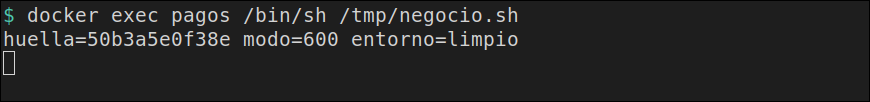

# La huella en el fichero

[← Página anterior](00-secreto-sin-echo.md) · [Siguiente página →](02-lab-secret-id-envuelto.md)

`negocio.sh` no conoce Vault. Lee `/tmp/clave`, comprueba que el modo es `600` y que `CLAVE` no está en el entorno, y escribe una huella. Al rotar el secreto, la huella cambia. El valor no aparece ni en esa salida ni en el log de Agent.

### Objetivo

Dos líneas `huella=… modo=600 entorno=limpio` con prefijos distintos, y `eco=no` al buscar `clave-v1` y `clave-v2` en las salidas y en el log.

### Punto de partida

```bash
bash infra/reiniciar-vault.sh
source infra/entorno.sh
```

Servidor vacío. El contenedor `pagos` se crea en esta página. Quítalo al final: el comando está en el último paso.

### En qué consiste

Preparar el rol, dejar Agent escribiendo el fichero y lanzar el proceso de negocio dos veces, antes y después de rotar.

### 1 — Guarda la primera clave

**Acción:**

```bash
vault kv put secret/pagos/api clave=clave-v1
```

**Por qué:** es el valor que Agent va a escribir en `/tmp/clave`. La prueba lo reconoce por la huella, así que esta escritura es el original de `1d697ee2f7be`.

**Resultado esperado:** la metadata muestra `version` `1`.

### 2 — Registra la policy

**Acción:**

```bash
bash infra/policy.sh solo-pagos <<'EOF'
path "secret/data/pagos/api" {
  capabilities = ["read"]
}
path "secret/metadata/pagos/api" {
  capabilities = ["read"]
}
EOF
```

**Por qué:** el token de Agent solo puede leer `secret/data/pagos/api`.

**Resultado esperado:** `Policy solo-pagos escrita.`

### 3 — Habilita AppRole y crea el rol

**Acción:**

```bash
vault auth enable approle
vault write auth/approle/role/pagos \
  token_policies=solo-pagos \
  token_ttl=15m \
  token_max_ttl=1h
```

**Por qué:** Agent entra con AppRole. El token `root` se queda en tu terminal.

**Resultado esperado:** `Success! Enabled approle auth method at: approle/` y `Success! Data written to: auth/approle/role/pagos`.

### 4 — Guarda los dos identificadores

**Acción:**

```bash
ROLE_ID=$(vault read -field=role_id auth/approle/role/pagos/role-id)
SECRET_ID=$(vault write -f -field=secret_id auth/approle/role/pagos/secret-id)
export ROLE_ID SECRET_ID
echo "role_len=${#ROLE_ID} secret_len=${#SECRET_ID}"
```

**Por qué:** Agent los lee de fichero dentro de `pagos`. Esta línea confirma que los tienes, sin volver a imprimirlos.

**Resultado esperado:** `role_len=36 secret_len=36`.

### 5 — Crea la máquina de la aplicación

**Acción:**

```bash
docker rm -f pagos >/dev/null 2>&1 || true
RED=$(docker inspect -f '{{range $k, $v := .NetworkSettings.Networks}}{{$k}}{{"\n"}}{{end}}' vault-dev | head -n 1)
echo "red=$RED"
docker run -d --name pagos --network "$RED" --entrypoint sleep hashicorp/vault:1.18 86400
```

**Por qué:** Agent corre al lado de la app, en la red de `vault-dev`. `sleep` mantiene el contenedor encendido mientras se copian los ficheros. Desde dentro, `127.0.0.1` es el propio contenedor.

**Resultado esperado:** `red=infra_default` y un identificador de contenedor.

### 6 — Copia el rol y el proceso de negocio

**Acción:**

```bash
printf '%s' "$ROLE_ID" | docker exec -i pagos tee /tmp/role_id >/dev/null
printf '%s' "$SECRET_ID" | docker exec -i pagos tee /tmp/secret_id >/dev/null
docker exec -i pagos tee /tmp/negocio.sh >/dev/null <<'EOF'
#!/bin/sh
set -eu
if [ -n "${CLAVE:-}" ]; then
  echo "CLAVE en entorno" >&2
  exit 1
fi
if [ ! -f /tmp/clave ]; then
  echo "falta fichero" >&2
  exit 1
fi
modo=$(stat -c %a /tmp/clave)
if [ "$modo" != "600" ]; then
  echo "modo=${modo}" >&2
  exit 1
fi
huella=$(sha256sum /tmp/clave | awk '{print substr($1,1,12)}')
echo "huella=${huella} modo=${modo} entorno=limpio"
EOF
docker exec pagos chmod +x /tmp/negocio.sh
```

**Por qué:** `negocio.sh` falla si alguien metió la clave en el entorno, si el fichero no está o si el modo queda abierto. La huella es lo único que escribe cuando las tres condiciones se cumplen.

**Resultado esperado:** los comandos terminan sin texto.

### 7 — Escribe la configuración de Agent

**Acción:**

```bash
docker exec -i pagos tee /tmp/agent.hcl >/dev/null <<'EOF'
pid_file = "/tmp/vault-agent.pid"

vault {
  address = "http://vault-dev:8200"
}

auto_auth {
  method "approle" {
    config = {
      role_id_file_path = "/tmp/role_id"
      secret_id_file_path = "/tmp/secret_id"
      remove_secret_id_file_after_reading = false
    }
  }
}

template_config {
  static_secret_render_interval = "5s"
}

template {
  destination = "/tmp/clave"
  perms = "0600"
  contents = "{{ with secret \"secret/data/pagos/api\" }}{{ .Data.data.clave }}{{ end }}"
}
EOF
```

**Por qué:** `template` escribe el valor en el fichero. `perms` deja el modo en `600`. El intervalo de cinco segundos es lo que hace que la rotación de un KV v2 se vea sin reiniciar Agent. `remove_secret_id_file_after_reading = false` deja el `secret_id` en su sitio por si Agent tiene que volver a autenticarse.

**Resultado esperado:** termina sin texto.

> [!NOTE]
> Un `exec` en este `agent.hcl` no arranca. Vault 1.18 responde `must specify at least one 'env_template' element with a top-level 'exec' element`. Si añades el `env_template` al lado del `template`, responde `'template' cannot be specified with 'env_template' entries`. El fichero y el `exec` de variable no caben en el mismo agente.

### 8 — Arranca Agent y lee la primera huella

**Acción:**

```bash
docker exec -d pagos sh -c 'vault agent -config=/tmp/agent.hcl > /tmp/agent.log 2>&1'
for i in $(seq 1 30); do
  docker exec pagos test -f /tmp/clave && break
  sleep 0.2
done
docker exec pagos /bin/sh /tmp/negocio.sh | tee /tmp/h1.txt
```

**Por qué:** Agent queda en segundo plano, entra y renderiza. El proceso de negocio se lanza después, cuando el fichero ya existe. `tee` guarda la línea para compararla con la siguiente.

**Resultado esperado:** `huella=1d697ee2f7be modo=600 entorno=limpio`.


### 9 — Rota la clave y espera la huella nueva

**Acción:**

```bash
vault kv put secret/pagos/api clave=clave-v2
H1=$(cut -d' ' -f1 /tmp/h1.txt)
for i in $(seq 1 12); do
  docker exec pagos /bin/sh /tmp/negocio.sh > /tmp/h2.txt
  grep -q "$H1" /tmp/h2.txt || break
  sleep 1
done
echo "esperas=$i"
cat /tmp/h2.txt
```

**Por qué:** el `put` deja la versión 2. Agent relee cada cinco segundos y reescribe `/tmp/clave`. El bucle vuelve a lanzar el script hasta que la huella ya no es la primera. El script no se edita.

**Resultado esperado:** la metadata del `put` muestra `version` `2`. `esperas=` es un entero pequeño. La línea siguiente es `huella=50b3a5e0f38e modo=600 entorno=limpio`.



> [!TIP]
> Si `esperas=12` y la huella no ha cambiado, a `agent.hcl` le falta `static_secret_render_interval`. Sin ese intervalo un KV v2 no se vuelve a leer.

### 10 — Busca el valor en lo que ha salido

**Acción:**

```bash
docker exec pagos cat /tmp/agent.log > /tmp/agent-host.log
if grep -E 'clave-v1|clave-v2' /tmp/h1.txt /tmp/h2.txt /tmp/agent-host.log; then
  echo eco=si
else
  echo eco=no
fi
```

**Por qué:** la prueba afirma la huella y, en el mismo sitio, afirma que el valor no está en la salida del negocio ni en el log de Agent. `grep` sin coincidencias es el resultado bueno.

**Resultado esperado:** `eco=no`.


### 11 — Quita el contenedor

**Acción:**

```bash
docker rm -f pagos >/dev/null
```

**Por qué:** Agent sigue vivo dentro de `pagos`. Este comando lo para y borra la máquina. El servidor `vault-dev` sigue.

**Resultado esperado:** termina sin texto.

> [!WARNING]
> Mientras `pagos` exista, Agent sigue reescribiendo `/tmp/clave` cada cinco segundos. Si pasas a otra página sin este paso, `bash infra/reiniciar-vault.sh` también lo elimina.

## Comprueba tu entendimiento

**La huella se puede recalcular sin abrir el fichero**
`printf '%s' 'clave-v2' | sha256sum | awk '{print substr($1,1,12)}'`
→ `50b3a5e0f38e`, el mismo prefijo que escribió el script después de rotar.

## Reto

### 1 — Un fichero con el modo abierto

Con el contenedor todavía en marcha (vuelve a crearlo con los pasos 5 a 8 si ya lo quitaste), cambia `perms` a `"0644"`, rearranca Agent y lanza otra vez `/tmp/negocio.sh`.

<details>
<summary>Ver solución</summary>

```bash
docker exec pagos sh -c 'kill $(cat /tmp/vault-agent.pid) || true'
docker exec pagos sed -i 's/0600/0644/' /tmp/agent.hcl
docker exec pagos rm -f /tmp/clave /tmp/vault-agent.pid
docker exec -d pagos sh -c 'vault agent -config=/tmp/agent.hcl > /tmp/agent.log 2>&1'
for i in $(seq 1 30); do
  docker exec pagos test -f /tmp/clave && break
  sleep 0.2
done
docker exec pagos /bin/sh /tmp/negocio.sh
```

El script termina en código 1 y escribe `modo=644` por la salida de error. No imprime huella. Al acabar: `docker rm -f pagos`.

</details>

## Errores frecuentes

| Síntoma | Causa probable | Cómo arreglarlo |
|---------|----------------|-----------------|
| `CLAVE en entorno` | El `agent.hcl` tiene un `env_template "CLAVE"` | Vuelve al `template` de fichero del paso 7 y rearranca Agent |
| `falta fichero` | Agent todavía no ha renderizado, o no arrancó | `docker exec pagos tail /tmp/agent.log` y repite el bucle del paso 8 |
| La segunda huella es igual que la primera y `esperas=12` | Falta `static_secret_render_interval` | Paso 7, otra vez, y rearranca Agent |
| `eco=si` | Algún `echo` o un `cat /tmp/clave` se coló en los ficheros que buscas | Borra `/tmp/h1.txt` y `/tmp/h2.txt` y repite los pasos 8 y 9 sin volcar el fichero |
| `role_len=` vacío | Los identificadores se quedaron en otra terminal | Repite el paso 4 en esta |
