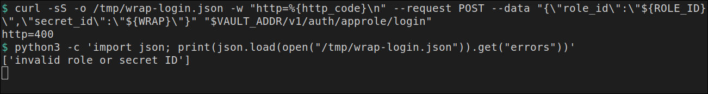
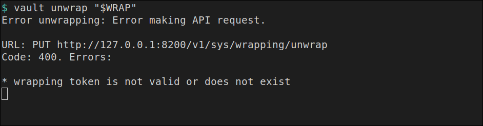

# secret_id envuelto

[← Página anterior](01-lab-huella-del-codigo.md) · [Siguiente página →](03-lab-firma-transit.md)

El canal por el que viaja el `secret_id` puede acabar en un log. Lo que se escribe ahí es un wrapping token de tres minutos. No entra en el login. Agent lo abre una vez, borra el fichero y el segundo unwrap ya no existe.

### Objetivo

`wrap_len=95`, un login `400` con el mensaje `invalid role or secret ID`, `authentication successful` en el log de Agent, `fichero=borrado` y un unwrap final con `wrapping token is not valid or does not exist`.

### Punto de partida

```bash
bash infra/reiniciar-vault.sh
source infra/entorno.sh
```

Servidor vacío. El contenedor `pagos` se crea aquí. El `WRAP` de esta terminal no se imprime: solo se usa en las variables de los comandos.

### En qué consiste

Crear el rol, pedir el `secret_id` envuelto, comprobar que ese token no entra y dejar que Agent lo gaste.

### 1 — Prepara policy, AppRole y el rol

**Acción:**

```bash
bash infra/policy.sh solo-pagos <<'EOF'
path "secret/data/pagos/api" {
  capabilities = ["read"]
}
EOF
vault auth enable approle
vault write auth/approle/role/pagos \
  token_policies=solo-pagos \
  token_ttl=15m \
  token_max_ttl=1h
ROLE_ID=$(vault read -field=role_id auth/approle/role/pagos/role-id)
export ROLE_ID
echo "role_len=${#ROLE_ID}"
```

**Por qué:** Agent necesita un rol al que pertenecerá el `secret_id` envuelto. La policy no se usa para leer un KV en esta página: la plantilla escribe la palabra `ok`. El rol existe para que el login sea el de `pagos`.

**Resultado esperado:** `Policy solo-pagos escrita.`, el alta de AppRole, `Success! Data written to: auth/approle/role/pagos` y `role_len=36`.

### 2 — Crea la máquina y copia el role_id

**Acción:**

```bash
docker rm -f pagos >/dev/null 2>&1 || true
RED=$(docker inspect -f '{{range $k, $v := .NetworkSettings.Networks}}{{$k}}{{"\n"}}{{end}}' vault-dev | head -n 1)
echo "red=$RED"
docker run -d --name pagos --network "$RED" --entrypoint sleep hashicorp/vault:1.18 86400
printf '%s' "$ROLE_ID" | docker exec -i pagos tee /tmp/role_id >/dev/null
```

**Por qué:** el wrapping token se va a copiar a un fichero de ese contenedor. El `role_id` ya puede estar ahí; el `secret_id` todavía no, porque aún no existe el envoltorio.

**Resultado esperado:** `red=infra_default` y un identificador de contenedor. El `tee` no imprime el `role_id`.

### 3 — Pide el secret_id envuelto

**Acción:**

```bash
WRAP=$(vault write -wrap-ttl=3m -field=wrapping_token -f auth/approle/role/pagos/secret-id)
echo "wrap_len=${#WRAP}"
```

**Por qué:** `-wrap-ttl=3m` guarda la respuesta dentro de un wrapping token que caduca a los tres minutos. `-field=wrapping_token` deja en `WRAP` solo ese token. La línea que sí se ve es la longitud, que en este laboratorio es 95. El `secret_id` va dentro y no forma parte de esta salida.

**Resultado esperado:** `wrap_len=95`.

> [!WARNING]
> Tres minutos dan para los pasos que siguen. Si Agent arranca cuando el plazo ya pasó, el log dice `wrapping token is not valid or does not exist` en el primer intento. Repite este paso y el resto desde aquí.

### 4 — Intenta entrar con el wrapping token

**Acción:**

```bash
curl -sS -o /tmp/wrap-login.json -w "http=%{http_code}\n" --request POST \
  --data "{\"role_id\":\"${ROLE_ID}\",\"secret_id\":\"${WRAP}\"}" \
  "${VAULT_ADDR}/v1/auth/approle/login"
python3 -c 'import json; print(json.load(open("/tmp/wrap-login.json")).get("errors"))'
```

**Por qué:** un echo del token de entrega, pegado en el campo `secret_id`, es el fallo que esta prueba busca. El POST no abre el envoltorio, así que `WRAP` sigue valiendo para Agent.

**Resultado esperado:** `http=400` y `['invalid role or secret ID']`.



### 5 — Deja el token donde Agent lo va a abrir

**Acción:**

```bash
printf '%s' "$WRAP" | docker exec -i pagos tee /tmp/secret_id >/dev/null
docker exec -i pagos tee /tmp/wrap.hcl >/dev/null <<'EOF'
pid_file = "/tmp/vault-agent.pid"

vault {
  address = "http://vault-dev:8200"
}

auto_auth {
  method "approle" {
    config = {
      role_id_file_path = "/tmp/role_id"
      secret_id_file_path = "/tmp/secret_id"
      remove_secret_id_file_after_reading = true
      secret_id_response_wrapping_path = "auth/approle/role/pagos/secret-id"
    }
  }
}

template {
  destination = "/tmp/entrada"
  contents = "ok"
}
EOF
```

**Por qué:** `secret_id_response_wrapping_path` le dice a Agent que el fichero contiene un envoltorio creado en `auth/approle/role/pagos/secret-id`, y que lo abra antes de entrar. `remove_secret_id_file_after_reading = true` borra el fichero al leerlo. El `template` con el texto `ok` cumple la condición de arranque del auto-auth y no escribe la clave.

**Resultado esperado:** termina sin texto.

### 6 — Arranca Agent y mira la entrada

**Acción:**

```bash
docker exec -d pagos sh -c 'vault agent -config=/tmp/wrap.hcl > /tmp/wrap.log 2>&1'
for i in $(seq 1 30); do
  docker exec pagos grep -q 'authentication successful' /tmp/wrap.log && break
  sleep 0.2
done
docker exec pagos grep -F 'authentication successful' /tmp/wrap.log
docker exec pagos cat /tmp/entrada
docker exec pagos sh -c 'if [ -f /tmp/secret_id ]; then echo fichero=sigue; else echo fichero=borrado; fi'
```

**Por qué:** la línea `authentication successful` es la prueba de que el unwrap interno y el login ocurrieron. `/tmp/entrada` confirma que el agente llegó a renderizar. El fichero del token ya no está, así que un segundo proceso no puede volver a leerlo.

**Resultado esperado:** una línea de log con `authentication successful`, luego `ok` y `fichero=borrado`.

### 7 — Abre el mismo token desde tu terminal

**Acción:**

```bash
vault unwrap "$WRAP" || true
```

**Por qué:** el wrapping token es de un solo uso. Agent ya lo gastó. Este comando es el echo tardío: alguien que copie el token del log de entrega llega tarde.

**Resultado esperado:** el comando termina en código 2. En el texto están `Code: 400` y `wrapping token is not valid or does not exist`. No aparece un `secret_id`.



### 8 — Quita el contenedor

**Acción:**

```bash
docker rm -f pagos >/dev/null
```

**Por qué:** Agent sigue renovando el token dentro de `pagos`. Este comando lo para.

**Resultado esperado:** termina sin texto.

## Comprueba tu entendimiento

**El POST del paso 4 no gasta el envoltorio**
Si repitieras el `curl` del paso 4 antes de arrancar Agent, el HTTP seguiría siendo 400 y Agent, después, entraría igual.
→ El login con un wrapping token en el campo `secret_id` no llama a `sys/wrapping/unwrap`.

## Reto

### 1 — Volver a dejar el mismo token en el fichero

Con `WRAP` todavía en esta terminal y `pagos` en marcha (rehaz los pasos 2, 5 y 6 si ya lo quitaste), copia otra vez el mismo token a `/tmp/secret_id` y arranca Agent de nuevo. Mira el log un segundo y páralo.

<details>
<summary>Ver solución</summary>

```bash
docker exec pagos sh -c 'kill $(cat /tmp/vault-agent.pid) 2>/dev/null || true'
printf '%s' "$WRAP" | docker exec -i pagos tee /tmp/secret_id >/dev/null
docker exec -d pagos sh -c 'vault agent -config=/tmp/wrap.hcl > /tmp/wrap2.log 2>&1'
sleep 1
docker exec pagos grep -F 'wrapping token is not valid' /tmp/wrap2.log
docker exec pagos sh -c 'kill $(cat /tmp/vault-agent.pid) 2>/dev/null || true'
docker rm -f pagos >/dev/null
```

El log contiene `error looking up wrapped secret ID` y `wrapping token is not valid or does not exist`. Agent consulta `sys/wrapping/lookup` y no entra.

</details>

## Errores frecuentes

| Síntoma | Causa probable | Cómo arreglarlo |
|---------|----------------|-----------------|
| `permission denied` y, en `docker logs vault-dev`, `login attempts exceeded` | Falta `secret_id_response_wrapping_path`. Agent usa el wrapping token como `secret_id`, reintenta y a la quinta el rol queda bloqueado | `bash infra/reiniciar-vault.sh`, `source infra/entorno.sh` y repite la página. El camino del envoltorio va en el paso 5 |
| `no known secret ID` | El fichero `/tmp/secret_id` no está. Agent ya lo borró o el `printf` no llegó | Repite los pasos 3 y 5. Hace falta un wrapping token nuevo |
| El unwrap del paso 7 imprime un `secret_id` | Agent no llegó a abrirlo. El token sigue entero | Mira el paso 6. Tiene que haber `authentication successful` antes del unwrap |
| `wrap_len=` vacío | El `vault write -wrap-ttl` falló o la variable se quedó en otra terminal | Paso 3, en esta terminal, y sigue desde ahí dentro de los tres minutos |
| `authentication successful` no aparece y el log habla de `permission denied` en el login | El rol está bloqueado por los reintentos anteriores | Reinicia Vault y no arranques Agent sin el `secret_id_response_wrapping_path` |
