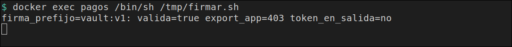
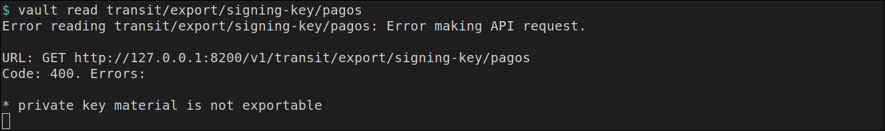

# La app firma

[← Página anterior](02-lab-secret-id-envuelto.md) · [Siguiente página →](04-lab-ssh-ca.md)

La aplicación de pagos tiene que firmar el texto `pago:42`. No recibe una clave. Vault Agent entra con el rol `firma`, escucha en el propio contenedor y añade el token. Transit devuelve una firma `vault:v1:`. La clave privada no se exporta, ni con el token de la app ni con el token `root`.

### Objetivo

La línea `firma_prefijo=vault:v1: valida=true export_app=403 token_en_salida=no`, y un `vault read` de la clave de firma con `Code: 400` y `private key material is not exportable`.

### Punto de partida

```bash
bash infra/reiniciar-vault.sh
source infra/entorno.sh
```

Servidor vacío. El motor `transit` se habilita en esta página. El contenedor `pagos` también.

### En qué consiste

Crear una clave que no se puede exportar, un rol que solo firma y verifica, y un proxy de Agent por el que pasa `firmar.sh`.

### 1 — Habilita Transit y crea la clave

**Acción:**

```bash
vault secrets enable transit
vault write -f transit/keys/pagos type=ed25519
```

**Por qué:** `type=ed25519` es una clave de firma. El alta no pide `exportable=true`, así que la clave privada se queda en Vault. La respuesta incluye `public_key`: esa mitad pública no firma sola.

**Resultado esperado:** `Success! Enabled the transit secrets engine at: transit/`. En la ficha de la clave, `exportable` es `false`, `supports_signing` es `true` y `type` es `ed25519`.

### 2 — Registra la policy de firma

**Acción:**

```bash
bash infra/policy.sh firma-pagos <<'EOF'
path "transit/sign/pagos" {
  capabilities = ["update"]
}
path "transit/verify/pagos" {
  capabilities = ["update"]
}
EOF
```

**Por qué:** firmar y verificar son un `POST`, y en Vault eso es la capability `update`. La policy no tiene `transit/export`, ni lectura de `secret/`. El rol de la app no puede sacar la clave ni leer el KV de pagos.

**Resultado esperado:** `Policy firma-pagos escrita.`

### 3 — Crea el rol firma

**Acción:**

```bash
vault auth enable approle
vault write auth/approle/role/firma \
  token_policies=firma-pagos \
  token_ttl=15m \
  token_max_ttl=1h
FROLE=$(vault read -field=role_id auth/approle/role/firma/role-id)
FSECRET=$(vault write -f -field=secret_id auth/approle/role/firma/secret-id)
export FROLE FSECRET
echo "frole_len=${#FROLE} fsecret_len=${#FSECRET}"
```

**Por qué:** Agent entra con este rol. Los dos identificadores se quedan en la terminal para copiarlos al contenedor. La línea visible es solo la longitud.

**Resultado esperado:** el alta de AppRole, `Success! Data written to: auth/approle/role/firma` y `frole_len=36 fsecret_len=36`.

### 4 — Crea la máquina y copia los identificadores

**Acción:**

```bash
docker rm -f pagos >/dev/null 2>&1 || true
RED=$(docker inspect -f '{{range $k, $v := .NetworkSettings.Networks}}{{$k}}{{"\n"}}{{end}}' vault-dev | head -n 1)
echo "red=$RED"
docker run -d --name pagos --network "$RED" --entrypoint sleep hashicorp/vault:1.18 86400
printf '%s' "$FROLE" | docker exec -i pagos tee /tmp/frole >/dev/null
printf '%s' "$FSECRET" | docker exec -i pagos tee /tmp/fsecret >/dev/null
```

**Por qué:** el proxy escucha en `127.0.0.1` de `pagos`. Ese puerto no se publica en tu máquina. La app y Agent comparten el contenedor, y desde fuera no hay un listener con el token de la app.

**Resultado esperado:** `red=infra_default` y un identificador de contenedor.

### 5 — Escribe el script que firma

**Acción:**

```bash
docker exec -i pagos tee /tmp/firmar.sh >/dev/null <<'EOF'
#!/bin/sh
set -eu
IN=$(printf %s 'pago:42' | base64 | tr -d '\n')
resp=$(wget -qO- --header='Content-Type: application/json' \
  --post-data="{\"input\":\"$IN\"}" \
  http://127.0.0.1:8100/v1/transit/sign/pagos)
firma=$(printf %s "$resp" | sed -n 's/.*"signature":"\([^"]*\)".*/\1/p')
case "$firma" in
  vault:v1:*) ;;
  *) echo "firma inesperada" >&2; exit 1 ;;
esac
ver=$(wget -qO- --header='Content-Type: application/json' \
  --post-data="{\"input\":\"$IN\",\"signature\":\"$firma\"}" \
  http://127.0.0.1:8100/v1/transit/verify/pagos)
printf %s "$ver" | grep -q '"valid":true'
codigo=$(wget -S -O /dev/null "http://127.0.0.1:8100/v1/transit/export/signing-key/pagos" 2>&1 | awk '/HTTP\// {print $2; exit}')
if printf %s "$resp$ver" | grep -q 'hvs\.'; then
  echo "token en salida" >&2
  exit 1
fi
echo "firma_prefijo=$(printf %s "$firma" | cut -c1-9) valida=true export_app=${codigo} token_en_salida=no"
EOF
docker exec pagos chmod +x /tmp/firmar.sh
```

**Por qué:** Transit quiere el texto en base64. El script se queda el campo `signature`, comprueba que verifica y pide el export. La línea que imprime lleva el prefijo `vault:v1:`, `valida=true` y el HTTP del export. Si la respuesta trajera un token `hvs.`, el script se detendría.

**Resultado esperado:** termina sin texto.

### 6 — Escribe el proxy de Agent

**Acción:**

```bash
docker exec -i pagos tee /tmp/proxy.hcl >/dev/null <<'EOF'
pid_file = "/tmp/vault-agent.pid"

vault {
  address = "http://vault-dev:8200"
}

auto_auth {
  method "approle" {
    config = {
      role_id_file_path = "/tmp/frole"
      secret_id_file_path = "/tmp/fsecret"
      remove_secret_id_file_after_reading = false
    }
  }
}

listener "tcp" {
  address = "127.0.0.1:8100"
  tls_disable = true
}

api_proxy {
  use_auto_auth_token = true
}
EOF
```

**Por qué:** `use_auto_auth_token = true` hace que una petición sin token reciba el token de Agent. `firmar.sh` no tiene `VAULT_TOKEN` ni un fichero de token. El listener está en el loopback del contenedor.

**Resultado esperado:** termina sin texto.

### 7 — Arranca Agent y firma

**Acción:**

```bash
docker exec -d pagos sh -c 'vault agent -config=/tmp/proxy.hcl > /tmp/proxy.log 2>&1'
for i in $(seq 1 30); do
  docker exec pagos grep -q 'authentication successful' /tmp/proxy.log && break
  sleep 0.2
done
docker exec pagos /bin/sh /tmp/firmar.sh
```

**Por qué:** el script habla con `127.0.0.1:8100` cuando Agent ya entró. La firma demuestra que el rol `firma` pudo hacer `transit/sign` y `transit/verify`. El `403` demuestra que ese mismo rol no exporta la clave.

**Resultado esperado:** `firma_prefijo=vault:v1: valida=true export_app=403 token_en_salida=no`.



> [!NOTE]
> `docker exec pagos head -n 1 /tmp/proxy.log` muestra el aviso de que el proxy de Agent pasa al subcomando `vault proxy`. La línea de la firma no depende de ese aviso.

### 8 — Pide la clave privada con el token root

**Acción:**

```bash
vault read transit/export/signing-key/pagos || true
```

**Por qué:** el `403` del paso anterior es la policy de la app. Este paso usa el token que lo puede todo en el laboratorio. La clave se creó sin permiso de exportar, así que tampoco hay una respuesta con el material privado.

**Resultado esperado:** el comando termina en código 2. En el texto están `Code: 400` y `private key material is not exportable`.



### 9 — Quita el contenedor

**Acción:**

```bash
docker rm -f pagos >/dev/null
```

**Por qué:** el proxy sigue escuchando mientras `pagos` exista.

**Resultado esperado:** termina sin texto.

## Comprueba tu entendimiento

**La mitad pública no es la firma**
En la salida del paso 1, `public_key` es una línea. `supports_signing` es `true` y `exportable` es `false`.
→ Firmar sigue siendo un `POST` a `transit/sign/pagos`. La clave privada no está en esa ficha.

## Reto

### 1 — Verificar la firma con otro texto

Con `pagos` todavía en marcha (repite desde el paso 4 si ya lo quitaste), pide la firma de `pago:42` y verifícala como si el texto fuera `pago:43`.

<details>
<summary>Ver solución</summary>

```bash
docker exec pagos sh -c '
IN42=$(printf %s "pago:42" | base64 | tr -d "\n")
IN43=$(printf %s "pago:43" | base64 | tr -d "\n")
SIG=$(wget -qO- --header="Content-Type: application/json" \
  --post-data="{\"input\":\"$IN42\"}" \
  http://127.0.0.1:8100/v1/transit/sign/pagos \
  | sed -n "s/.*\"signature\":\"\([^\"]*\)\".*/\1/p")
wget -qO- --header="Content-Type: application/json" \
  --post-data="{\"input\":\"$IN43\",\"signature\":\"$SIG\"}" \
  http://127.0.0.1:8100/v1/transit/verify/pagos
echo
'
docker rm -f pagos >/dev/null
```

El JSON trae `"valid":false`. La firma es de `pago:42`.

</details>

## Errores frecuentes

| Síntoma | Causa probable | Cómo arreglarlo |
|---------|----------------|-----------------|
| `wget: server returned error: HTTP/1.1 403 Forbidden` al firmar | La policy no tiene `transit/sign/pagos` con `update`, o Agent entró con otro rol | Repite los pasos 2 y 3 y copia de nuevo los identificadores |
| `firma inesperada` | El proxy todavía no escuchaba, o `8100` no es el listener | Espera a `authentication successful` en `/tmp/proxy.log` y lanza otra vez el script |
| El export de la app sale `200` | La policy incluye `transit/export` | Vuelve a escribir `firma-pagos` como en el paso 2. El token nuevo de Agent coge la policy al entrar; rearranca Agent |
| `private key material is not exportable` no sale y el `vault read` imprime material | La clave se creó con `exportable=true` | `bash infra/reiniciar-vault.sh` y créala con el `vault write` del paso 1, sin ese parámetro |
| `frole_len=` vacío | `export` se hizo en otra terminal | Paso 3, en esta |
