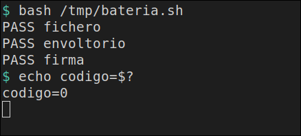

# La batería

[← Página anterior](03-lab-firma-transit.md)

Las tres pruebas caben en un script. Al terminar escribe `PASS fichero`, `PASS envoltorio` y `PASS firma`, y sale con código 0. Si una falla, esa línea es `FAIL` y el código es 1.

### Objetivo

`/tmp/bateria.sh` termina en 0 y las tres líneas son `PASS`. En esa salida no aparece `clave-pagos`.

### Punto de partida

```bash
bash infra/reiniciar-vault.sh
source infra/entorno.sh
```

Servidor vacío, desde la raíz del repo. El script llama a `vault` dentro de `vault-dev` y usa `VAULT_ADDR` de esta terminal para el login del envoltorio. Si abres otra terminal, vuelve a cargar `source infra/entorno.sh`.

### En qué consiste

El script prepara el KV, las dos policies, Transit y los dos roles. Luego afirma, en este orden:

- **fichero** — la huella de `clave-pagos`, modo `600`, `entorno=limpio`, y ni la salida ni el log de Agent contienen el valor.
- **envoltorio** — el wrapping token en el campo `secret_id` da HTTP 400, Agent entra, borra el fichero y el segundo unwrap ya no existe. El log de Agent no contiene el token.
- **firma** — el prefijo es `vault:v1:`, la verificación es válida, el export de la app es 403, la salida no lleva un token `hvs.` y el token `root` recibe `private key material is not exportable`.

### 1 — Escribe el script

**Acción:**

```bash
cat > /tmp/bateria.sh << 'ENDSCRIPT'
#!/usr/bin/env bash
# Tres pruebas. La salida tiene que ser tres PASS.
set -u
pasa=0
falla=0
marca() {
  if [[ "$2" == "si" ]]; then
    echo "PASS $1"
    pasa=$((pasa + 1))
  else
    echo "FAIL $1"
    falla=$((falla + 1))
  fi
}
v() {
  docker exec \
    -e VAULT_ADDR=http://127.0.0.1:8200 \
    -e VAULT_TOKEN=root \
    vault-dev vault "$@"
}

v kv put secret/pagos/api clave=clave-pagos >/dev/null
bash infra/policy.sh solo-pagos <<'EOF' >/dev/null
path "secret/data/pagos/api" {
  capabilities = ["read"]
}
path "secret/metadata/pagos/api" {
  capabilities = ["read"]
}
EOF
bash infra/policy.sh firma-pagos <<'EOF' >/dev/null
path "transit/sign/pagos" {
  capabilities = ["update"]
}
path "transit/verify/pagos" {
  capabilities = ["update"]
}
EOF
v secrets enable transit >/dev/null
v write -f transit/keys/pagos type=ed25519 >/dev/null
v auth enable approle >/dev/null
v write auth/approle/role/pagos token_policies=solo-pagos token_ttl=15m token_max_ttl=1h >/dev/null
v write auth/approle/role/firma token_policies=firma-pagos token_ttl=15m token_max_ttl=1h >/dev/null
ROLE_ID=$(v read -field=role_id auth/approle/role/pagos/role-id)
SECRET_ID=$(v write -f -field=secret_id auth/approle/role/pagos/secret-id)
FROLE=$(v read -field=role_id auth/approle/role/firma/role-id)
FSECRET=$(v write -f -field=secret_id auth/approle/role/firma/secret-id)

docker rm -f pagos >/dev/null 2>&1 || true
RED=$(docker inspect -f '{{range $k, $v := .NetworkSettings.Networks}}{{$k}}{{"\n"}}{{end}}' vault-dev | head -n 1)
docker run -d --name pagos --network "$RED" --entrypoint sleep hashicorp/vault:1.18 86400 >/dev/null
printf '%s' "$ROLE_ID" | docker exec -i pagos tee /tmp/role_id >/dev/null
printf '%s' "$SECRET_ID" | docker exec -i pagos tee /tmp/secret_id >/dev/null
printf '%s' "$FROLE" | docker exec -i pagos tee /tmp/frole >/dev/null
printf '%s' "$FSECRET" | docker exec -i pagos tee /tmp/fsecret >/dev/null

docker exec -i pagos tee /tmp/negocio.sh >/dev/null <<'EOF'
#!/bin/sh
set -eu
if [ -n "${CLAVE:-}" ]; then
  echo "CLAVE en entorno" >&2
  exit 1
fi
modo=$(stat -c %a /tmp/clave)
huella=$(sha256sum /tmp/clave | awk '{print substr($1,1,12)}')
echo "huella=${huella} modo=${modo} entorno=limpio"
EOF
docker exec -i pagos tee /tmp/agent.hcl >/dev/null <<'EOF'
pid_file = "/tmp/vault-agent.pid"
vault {
  address = "http://vault-dev:8200"
}
auto_auth {
  method "approle" {
    config = {
      role_id_file_path = "/tmp/role_id"
      secret_id_file_path = "/tmp/secret_id"
      remove_secret_id_file_after_reading = false
    }
  }
}
template {
  destination = "/tmp/clave"
  perms = "0600"
  contents = "{{ with secret \"secret/data/pagos/api\" }}{{ .Data.data.clave }}{{ end }}"
}
EOF
docker exec -d pagos sh -c 'vault agent -config=/tmp/agent.hcl > /tmp/agent.log 2>&1'
ok=no
for _i in $(seq 1 30); do
  if docker exec pagos test -f /tmp/clave; then ok=si; break; fi
  sleep 0.2
done
salida=$(docker exec pagos /bin/sh /tmp/negocio.sh 2>&1 || true)
esperada=$(printf '%s' 'clave-pagos' | sha256sum | awk '{print substr($1,1,12)}')
if [[ "$ok" == "si" && "$salida" == "huella=${esperada} modo=600 entorno=limpio" ]] \
  && ! printf '%s' "$salida" | grep -q 'clave-pagos' \
  && ! docker exec pagos grep -q 'clave-pagos' /tmp/agent.log; then
  marca fichero si
else
  marca fichero no
  echo "$salida"
fi
docker exec pagos sh -c 'kill $(cat /tmp/vault-agent.pid) 2>/dev/null || true'
sleep 0.3

WRAP=$(v write -wrap-ttl=3m -field=wrapping_token -f auth/approle/role/pagos/secret-id)
login=$(curl -sS -o /tmp/b-login.json -w "%{http_code}" --request POST \
  --data "{\"role_id\":\"${ROLE_ID}\",\"secret_id\":\"${WRAP}\"}" \
  "${VAULT_ADDR}/v1/auth/approle/login")
printf '%s' "$WRAP" | docker exec -i pagos tee /tmp/secret_id >/dev/null
docker exec -i pagos tee /tmp/wrap.hcl >/dev/null <<'EOF'
pid_file = "/tmp/vault-agent.pid"
vault {
  address = "http://vault-dev:8200"
}
auto_auth {
  method "approle" {
    config = {
      role_id_file_path = "/tmp/role_id"
      secret_id_file_path = "/tmp/secret_id"
      remove_secret_id_file_after_reading = true
      secret_id_response_wrapping_path = "auth/approle/role/pagos/secret-id"
    }
  }
}
template {
  destination = "/tmp/entrada"
  contents = "ok"
}
EOF
docker exec -d pagos sh -c 'vault agent -config=/tmp/wrap.hcl > /tmp/wrap.log 2>&1'
auth=no
for _i in $(seq 1 30); do
  if docker exec pagos grep -q 'authentication successful' /tmp/wrap.log 2>/dev/null; then auth=si; break; fi
  sleep 0.2
done
fichero=sigue
if ! docker exec pagos test -f /tmp/secret_id; then fichero=borrado; fi
entrada=$(docker exec pagos cat /tmp/entrada 2>/dev/null || true)
v unwrap "$WRAP" >/tmp/b-unwrap.txt 2>&1 || true
if [[ "$login" == "400" && "$auth" == "si" && "$entrada" == "ok" && "$fichero" == "borrado" ]] \
  && grep -q 'wrapping token is not valid or does not exist' /tmp/b-unwrap.txt \
  && ! docker exec pagos grep -F "$WRAP" /tmp/wrap.log >/dev/null; then
  marca envoltorio si
else
  marca envoltorio no
fi
docker exec pagos sh -c 'kill $(cat /tmp/vault-agent.pid) 2>/dev/null || true'
sleep 0.3

docker exec -i pagos tee /tmp/firmar.sh >/dev/null <<'EOF'
#!/bin/sh
set -eu
IN=$(printf %s 'pago:42' | base64 | tr -d '\n')
resp=$(wget -qO- --header='Content-Type: application/json' \
  --post-data="{\"input\":\"$IN\"}" \
  http://127.0.0.1:8100/v1/transit/sign/pagos)
firma=$(printf %s "$resp" | sed -n 's/.*"signature":"\([^"]*\)".*/\1/p')
case "$firma" in
  vault:v1:*) ;;
  *) echo "firma inesperada" >&2; exit 1 ;;
esac
ver=$(wget -qO- --header='Content-Type: application/json' \
  --post-data="{\"input\":\"$IN\",\"signature\":\"$firma\"}" \
  http://127.0.0.1:8100/v1/transit/verify/pagos)
printf %s "$ver" | grep -q '"valid":true'
codigo=$(wget -S -O /dev/null "http://127.0.0.1:8100/v1/transit/export/signing-key/pagos" 2>&1 | awk '/HTTP\// {print $2; exit}')
if printf %s "$resp$ver" | grep -q 'hvs\.'; then
  echo "token en salida" >&2
  exit 1
fi
echo "firma_prefijo=$(printf %s "$firma" | cut -c1-9) valida=true export_app=${codigo} token_en_salida=no"
EOF
docker exec -i pagos tee /tmp/proxy.hcl >/dev/null <<'EOF'
pid_file = "/tmp/vault-agent.pid"
vault {
  address = "http://vault-dev:8200"
}
auto_auth {
  method "approle" {
    config = {
      role_id_file_path = "/tmp/frole"
      secret_id_file_path = "/tmp/fsecret"
      remove_secret_id_file_after_reading = false
    }
  }
}
listener "tcp" {
  address = "127.0.0.1:8100"
  tls_disable = true
}
api_proxy {
  use_auto_auth_token = true
}
EOF
docker exec -d pagos sh -c 'vault agent -config=/tmp/proxy.hcl > /tmp/proxy.log 2>&1'
listo=no
for _i in $(seq 1 30); do
  if docker exec pagos grep -q 'authentication successful' /tmp/proxy.log 2>/dev/null; then listo=si; break; fi
  sleep 0.2
done
firma=$(docker exec pagos /bin/sh /tmp/firmar.sh 2>&1 || true)
v read transit/export/signing-key/pagos >/tmp/b-export.txt 2>&1 || true
if [[ "$listo" == "si" && "$firma" == "firma_prefijo=vault:v1: valida=true export_app=403 token_en_salida=no" ]] \
  && grep -q 'private key material is not exportable' /tmp/b-export.txt; then
  marca firma si
else
  marca firma no
  echo "$firma"
fi
docker rm -f pagos >/dev/null

if [[ "$falla" -eq 0 && "$pasa" -eq 3 ]]; then
  exit 0
fi
exit 1
ENDSCRIPT
chmod +x /tmp/bateria.sh
```

**Por qué:** cada `PASS` es una afirmación del test, no un volcado del secreto. `v` ejecuta el CLI dentro de `vault-dev`, así el script no depende de tener el binario `vault` en tu terminal. El cierre borra `pagos`.

**Resultado esperado:** termina sin texto. `test -x /tmp/bateria.sh` no imprime nada y sale 0.

### 2 — Ejecuta la batería

**Acción:**

```bash
bash /tmp/bateria.sh
echo "codigo=$?"
```

**Por qué:** una sola ejecución recorre el fichero, el envoltorio y la firma. El código de salida distingue «las tres pasaron» de «alguna falló», que es lo que un job puede mirar sin leer el secreto.

**Resultado esperado:**

```text
PASS fichero
PASS envoltorio
PASS firma
codigo=0
```



### 3 — Confirma que el valor no está en esa salida

**Acción:**

```bash
bash /tmp/bateria.sh | tee /tmp/bateria.out
echo "codigo=${PIPESTATUS[0]}"
if grep -q 'clave-pagos' /tmp/bateria.out; then echo eco=si; else echo eco=no; fi
```

**Por qué:** el segundo arranque sigue siendo válido. `tee` guarda lo que vería un log de CI. `clave-pagos` es el valor que el script usó por dentro; si aparece aquí, la batería está enseñando el secreto.

**Resultado esperado:** las tres líneas `PASS`, `codigo=0` y `eco=no`. Por la salida de error pueden asomar dos líneas `path is already in use`, una de `transit/` y otra de `approle/`: el script vuelve a habilitar lo que el primer arranque ya dejó. Los `PASS` no dependen de ese texto.

## Comprueba tu entendimiento

**Qué cubre cada PASS**
`grep '^PASS ' /tmp/bateria.out`
→ Tres líneas: `PASS fichero`, `PASS envoltorio`, `PASS firma`.

## Reto

### 1 — Romper solo la firma

Quita de `/tmp/bateria.sh` el bloque de la policy que dice `path "transit/sign/pagos"`. Deja la URL `transit/sign/pagos` dentro de `firmar.sh`. Reinicia Vault, carga el entorno y ejecuta el script.

<details>
<summary>Ver solución</summary>

El bloque que se quita es este, y solo la primera vez que aparece (la policy):

```hcl
path "transit/sign/pagos" {
  capabilities = ["update"]
}
```

```bash
bash infra/reiniciar-vault.sh
source infra/entorno.sh
bash /tmp/bateria.sh
echo "codigo=$?"
```

```text
PASS fichero
PASS envoltorio
FAIL firma
wget: server returned error: HTTP/1.1 403 Forbidden
codigo=1
```

El 403 es el `POST` de firma. La clave privada no sale en esa línea. Para dejar el script verde, vuelve a pegar el bloque y repite el arranque.

</details>

## Errores frecuentes

| Síntoma | Causa probable | Cómo arreglarlo |
|---------|----------------|-----------------|
| `FAIL fichero` y una línea `huella=` distinta | El KV no tiene `clave-pagos` o el fichero se renderizó con otra cosa | `bash infra/reiniciar-vault.sh`, `source infra/entorno.sh` y el paso 2 |
| `FAIL envoltorio` | El login no fue 400, Agent no entró o el unwrap todavía devuelve el `secret_id` | Reinicia y ejecuta otra vez. Cinco logins fallidos bloquean el rol; el servidor limpio lo deshace |
| `FAIL firma` y `HTTP/1.1 403` | La policy `firma-pagos` no puede `transit/sign/pagos` | Es el reto, o el bloque de la policy se borró sin querer. Restaura el script del paso 1 |
| `VAULT_ADDR` vacío y `FAIL envoltorio` | El script se lanzó sin `source infra/entorno.sh` | Carga el entorno en esa terminal y repite |
| `path is already in use` y aun así tres `PASS` | Es el segundo arranque, sin reiniciar | La batería sigue siendo válida. Para una salida sin ese texto, reinicia antes |
| `codigo=1` con tres `PASS` | El `echo "codigo=$?"` se ejecutó en otra línea y `$?` ya no era el del script | Úsalo en la misma línea, como en el paso 2, o mira `PIPESTATUS[0]` como en el paso 3 |
