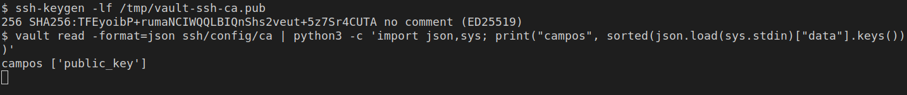
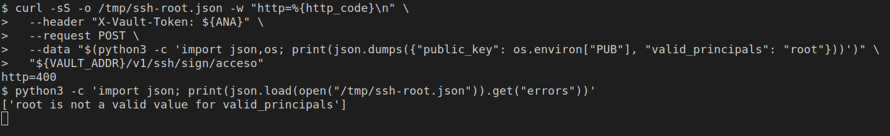

# Entrar por SSH

[← Página anterior](03-lab-firma-transit.md) · [Siguiente página →](05-lab-bateria.md)

Vault administra quién entra en un servidor. El servidor es un Ubuntu que arrancas con Docker: tiene `sshd`, el usuario de sistema `ana` y la clave pública de la CA de Vault. No tiene contraseña. `ana` entra en Vault con UserPass, Vault le firma un certificado de treinta minutos, y con ese certificado abre la sesión SSH. Sin el certificado, `sshd` responde `Permission denied`.

### Objetivo

Una sesión SSH que escribe `ana` y `acceso=ok`. Sin el fichero del certificado, la misma orden termina en `salida=255` y `Permission denied (publickey).` Pedir el principal `root` responde `http=400`.

### Punto de partida

```bash
bash infra/reiniciar-vault.sh
source infra/entorno.sh
```

Servidor vacío. Hace falta `ssh-keygen` y el cliente `ssh` en esta terminal (paquete `openssh-client`). Si no están:

```bash
sudo apt-get update -qq && sudo DEBIAN_FRONTEND=noninteractive apt-get install -y --no-install-recommends openssh-client
```

El contenedor `destino` se crea en esta página. Quítalo al final: el comando está en el último paso.

### En qué consiste

Crear la CA en el motor `ssh`, levantar el Ubuntu que confía en esa CA, entrar como `ana` con UserPass, firmar la clave pública y usar el certificado para entrar por SSH.

### 1 — Habilita el motor y genera la CA

**Acción:**

```bash
vault secrets enable -path=ssh ssh
vault write ssh/config/ca generate_signing_key=true key_type=ed25519
```

**Por qué:** el motor `ssh` en modo CA firma claves OpenSSH. No es el motor `pki` de certificados X.509. `key_type=ed25519` es la CA que acepta el `sshd` de Ubuntu 24.04. La respuesta muestra `public_key`. La privada se queda en Vault.

**Resultado esperado:** `Success! Enabled the ssh secrets engine at: ssh/`. En la ficha, `public_key` empieza por `ssh-ed25519`.

### 2 — Guarda la clave pública de la CA

**Acción:**

```bash
printf '%s\n' "$(vault read -field=public_key ssh/config/ca)" > /tmp/vault-ssh-ca.pub
ssh-keygen -lf /tmp/vault-ssh-ca.pub
vault read -format=json ssh/config/ca \
  | python3 -c 'import json,sys; print("campos", sorted(json.load(sys.stdin)["data"].keys()))'
```

**Por qué:** ese fichero es el que el servidor pondrá en `TrustedUserCAKeys`. La lista de campos confirma que la lectura no trae la privada.

**Resultado esperado:** una línea `256 SHA256:… (ED25519)` y `campos ['public_key']`. La huella cambia en cada arranque: Vault genera otra CA.



### 3 — Crea el rol de acceso

**Acción:**

```bash
curl -sS -o /dev/null -w "http=%{http_code}\n" \
  --header "X-Vault-Token: ${VAULT_TOKEN}" \
  --request POST \
  --data '{"key_type":"ca","allow_user_certificates":true,"allowed_users":"ana","default_user":"ana","allowed_extensions":"permit-pty","default_extensions":{"permit-pty":""},"ttl":"30m","max_ttl":"30m"}' \
  "${VAULT_ADDR}/v1/ssh/roles/acceso"
```

**Por qué:** el rol `acceso` solo puede firmar el principal `ana`, que es el usuario de sistema del servidor. `permit-pty` permite abrir un terminal. El certificado caduca a los treinta minutos. El cuerpo va en JSON porque `default_extensions` es un mapa: el CLI lo manda como texto y Vault responde 400.

**Resultado esperado:** `http=204`. Un 204 es el alta, sin cuerpo.

### 4 — Policy y UserPass de ana

**Acción:**

```bash
bash infra/policy.sh firma-ssh <<'EOF'
path "ssh/sign/acceso" {
  capabilities = ["create", "update"]
}
EOF
vault auth enable userpass
vault write auth/userpass/users/ana password=ana-lab policies=firma-ssh
```

**Por qué:** `ana` es una persona. Entra con usuario y contraseña, como en el módulo 4, y el token solo puede firmar en `ssh/sign/acceso`. No lee KV ni exporta la CA. El token `root` sigue en esta terminal para los pasos de administración.

**Resultado esperado:** `Policy firma-ssh escrita.`, `Success! Enabled userpass auth method at: userpass/` y `Success! Data written to: auth/userpass/users/ana`.

### 5 — Levanta el servidor

**Acción:**

```bash
docker rm -f destino >/dev/null 2>&1 || true
RED=$(docker inspect -f '{{range $k, $v := .NetworkSettings.Networks}}{{$k}}{{"\n"}}{{end}}' vault-dev | head -n 1)
echo "red=$RED"
docker run -d --name destino -p 127.0.0.1:2222:22 --network "$RED" ubuntu:24.04 sleep infinity
```

**Por qué:** `destino` es la máquina a la que Vault va a dar acceso. La imagen es Ubuntu 24.04, todavía sin SSH: `sleep infinity` solo la mantiene encendida. El puerto `2222` de esta máquina es el `22` del contenedor. La red es la de `vault-dev` por si desde esta terminal no llegas a `127.0.0.1:2222`.

**Resultado esperado:** `red=infra_default` y un identificador de contenedor. La primera vez Docker descarga `ubuntu:24.04`.

### 6 — Instala el servidor SSH

**Acción:**

```bash
docker exec destino bash -c 'export DEBIAN_FRONTEND=noninteractive; apt-get update -qq && apt-get install -y -qq openssh-server >/tmp/apt.log 2>&1 && echo sshd=instalado'
```

**Por qué:** el Ubuntu de Docker no trae `sshd`. Este paso lo instala dentro de `destino`. La salida de `apt` se queda en el contenedor.

**Resultado esperado:** `sshd=instalado`. Tarda un poco: está instalando el paquete.

### 7 — Confía en la CA y arranca sshd

**Acción:**

```bash
docker cp /tmp/vault-ssh-ca.pub destino:/etc/ssh/vault-ca.pub
docker exec destino bash -c 'useradd -m -s /bin/bash ana && usermod -p "*" ana && mkdir -p /run/sshd && printf "%s\n" "TrustedUserCAKeys /etc/ssh/vault-ca.pub" "PasswordAuthentication no" "KbdInteractiveAuthentication no" "PubkeyAuthentication yes" "UsePAM no" > /etc/ssh/sshd_config.d/vault.conf && ssh-keygen -A && /usr/sbin/sshd && echo sshd=escucha'
```

**Por qué:** `TrustedUserCAKeys` es la pública de Vault: `sshd` acepta certificados firmados por esa CA y rechaza el resto. `ana` existe como usuario de sistema, sin contraseña. `useradd` deja la cuenta bloqueada y `sshd` entonces ignora el certificado (`account is locked`); `usermod -p "*"` abre la cuenta sin crear una contraseña. `PasswordAuthentication no` cierra el otro camino.

**Resultado esperado:** `sshd=escucha`.

### 8 — Elige por dónde llegar al servidor

**Acción:**

```bash
IP=$(docker inspect -f '{{range .NetworkSettings.Networks}}{{.IPAddress}} {{end}}' destino | awk '{print $1}')
if timeout 2 bash -c 'echo >/dev/tcp/127.0.0.1/2222' 2>/dev/null; then
  SSH_HOST=127.0.0.1
  SSH_PORT=2222
else
  SSH_HOST=$IP
  SSH_PORT=22
fi
export SSH_HOST SSH_PORT
echo "ssh_host=${SSH_HOST} ssh_port=${SSH_PORT}"
```

**Por qué:** en Docker local el puerto publicado es `127.0.0.1:2222`. En un Codespace que no ve ese puerto, la sesión va a la IP de `destino` en la red de Vault, puerto `22`. Las órdenes siguientes usan estas dos variables.

**Resultado esperado:** `ssh_host=127.0.0.1 ssh_port=2222`, o `ssh_host=` con una IP y `ssh_port=22`.

### 9 — Genera el par de ana

**Acción:**

```bash
rm -f /tmp/ana-ssh /tmp/ana-ssh.pub /tmp/ana-ssh-cert.pub
ssh-keygen -t ed25519 -N '' -f /tmp/ana-ssh -C 'ana@lab' -q
stat -c 'modo=%a' /tmp/ana-ssh
```

**Por qué:** la clave privada nace en esta máquina, con modo `600`. Vault solo va a ver la pública. El certificado tendrá que llamarse `/tmp/ana-ssh-cert.pub`: OpenSSH lo busca al lado de `/tmp/ana-ssh`.

**Resultado esperado:** `modo=600`.

### 10 — Entra con UserPass y firma la pública

**Acción:**

```bash
curl -sS -o /tmp/ana.json -w "http=%{http_code}\n" --request POST \
  --data '{"password":"ana-lab"}' \
  "${VAULT_ADDR}/v1/auth/userpass/login/ana"
ANA=$(python3 -c 'import json; print(json.load(open("/tmp/ana.json"))["auth"]["client_token"])')
echo "token_len=${#ANA}"
export PUB="$(cat /tmp/ana-ssh.pub)"
curl -sS -o /tmp/ssh-sign.json -w "http=%{http_code}\n" \
  --header "X-Vault-Token: ${ANA}" \
  --request POST \
  --data "$(python3 -c 'import json,os; print(json.dumps({"public_key": os.environ["PUB"], "valid_principals": "ana"}))')" \
  "${VAULT_ADDR}/v1/ssh/sign/acceso"
python3 -c 'import json; d=json.load(open("/tmp/ssh-sign.json")); open("/tmp/ana-ssh-cert.pub","w").write(d["data"]["signed_key"]); print("cert_bytes", len(d["data"]["signed_key"]))'
```

**Por qué:** el login es el de `ana` / `ana-lab`. El token que firma es el suyo, no el `root`. Vault recibe la pública y el principal `ana`, y devuelve un certificado. La privada no sale de esta máquina.

**Resultado esperado:** el login es `http=200` y `token_len=95`. La firma es `http=200` y `cert_bytes` por encima de 500.

### 11 — Mira el certificado

**Acción:**

```bash
ssh-keygen -L -f /tmp/ana-ssh-cert.pub
```

**Por qué:** antes de entrar, el certificado dice quién es. El principal tiene que ser `ana`, la misma cuenta del servidor, y la ventana `Valid` es de treinta minutos.

**Resultado esperado:** en la salida aparecen:

- `Type: ssh-ed25519-cert-v01@openssh.com user certificate`
- `Principals:` y debajo `ana`
- `permit-pty`
- `Valid: from … to …` con un margen de treinta minutos

### 12 — Entra en el servidor

**Acción:**

```bash
ssh -i /tmp/ana-ssh \
  -o IdentitiesOnly=yes \
  -o StrictHostKeyChecking=no \
  -o UserKnownHostsFile=/dev/null \
  -o LogLevel=ERROR \
  -p "$SSH_PORT" \
  "ana@${SSH_HOST}" \
  'whoami; echo acceso=ok'
```

**Por qué:** esta es la prueba de integración. `sshd` acepta el certificado porque está firmado por la CA que tiene en `TrustedUserCAKeys` y el principal es el usuario `ana`. No hay contraseña en el servidor.

**Resultado esperado:**

```text
ana
acceso=ok
```


### 13 — Sin el certificado no hay sesión

**Acción:**

```bash
mv /tmp/ana-ssh-cert.pub /tmp/ana-ssh-cert.bak
ssh -i /tmp/ana-ssh \
  -o IdentitiesOnly=yes \
  -o StrictHostKeyChecking=no \
  -o UserKnownHostsFile=/dev/null \
  -o LogLevel=ERROR \
  -o BatchMode=yes \
  -o ConnectTimeout=5 \
  -p "$SSH_PORT" \
  "ana@${SSH_HOST}" 'whoami' || echo "salida=$?"
mv /tmp/ana-ssh-cert.bak /tmp/ana-ssh-cert.pub
```

**Por qué:** la clave privada sola no está en `authorized_keys`. El servidor solo fía de la CA de Vault. Al apartar el certificado, la misma clave deja de entrar. El `mv` final lo devuelve a su sitio.

**Resultado esperado:** una línea `Permission denied (publickey).` y `salida=255`.

### 14 — Un principal que el rol no firma

**Acción:**

```bash
export PUB="$(cat /tmp/ana-ssh.pub)"
curl -sS -o /tmp/ssh-root.json -w "http=%{http_code}\n" \
  --header "X-Vault-Token: ${ANA}" \
  --request POST \
  --data "$(python3 -c 'import json,os; print(json.dumps({"public_key": os.environ["PUB"], "valid_principals": "root"}))')" \
  "${VAULT_ADDR}/v1/ssh/sign/acceso"
python3 -c 'import json; print(json.load(open("/tmp/ssh-root.json")).get("errors"))'
```

**Por qué:** el rol solo admite `ana`. Pedir `root` no produce un certificado de administrador: Vault responde 400.

**Resultado esperado:** `http=400` y `['root is not a valid value for valid_principals']`.



### 15 — Quita el servidor

**Acción:**

```bash
docker rm -f destino >/dev/null
```

**Por qué:** para `sshd` y libera el puerto `2222`. El servidor `vault-dev` sigue.

**Resultado esperado:** termina sin texto.

> [!WARNING]
> Si pasas a otra página sin este paso, `bash infra/reiniciar-vault.sh` también elimina `destino`.

## Comprueba tu entendimiento

**La privada de ana no viajó a Vault**
`grep -c PRIVATE /tmp/ana-ssh-cert.pub; stat -c 'modo=%a' /tmp/ana-ssh`
→ El certificado imprime `0`. La clave privada sigue en `/tmp/ana-ssh`, modo `600`.

## Reto

### 1 — El certificado de ana no sirve para root

Con `destino` todavía en marcha y el certificado en su sitio, intenta entrar como `root` usando `/tmp/ana-ssh`.

<details>
<summary>Ver solución</summary>

```bash
ssh -i /tmp/ana-ssh \
  -o IdentitiesOnly=yes \
  -o StrictHostKeyChecking=no \
  -o UserKnownHostsFile=/dev/null \
  -o LogLevel=ERROR \
  -o BatchMode=yes \
  -o ConnectTimeout=5 \
  -p "$SSH_PORT" \
  "root@${SSH_HOST}" 'whoami' || echo "salida=$?"
```

`Permission denied (publickey).` y `salida=255`. El certificado dice principal `ana`. `sshd` no lo acepta para `root`. Al acabar: `docker rm -f destino`.

</details>

## Errores frecuentes

| Síntoma | Causa probable | Cómo arreglarlo |
|---------|----------------|-----------------|
| `ssh-keygen: command not found` o `ssh: command not found` | Falta `openssh-client` | El `apt-get` del punto de partida |
| `account is locked` en el log de `sshd`, y la sesión es `Permission denied` | Falta `usermod -p "*"` | Repite el paso 7 |
| `Permission denied` en el paso 12 | El certificado no está en `/tmp/ana-ssh-cert.pub`, o `SSH_HOST` apunta a otro sitio | Repite los pasos 8, 10 y 12. `echo "$SSH_HOST $SSH_PORT"` tiene que coincidir con un `destino` vivo |
| `http=403` al firmar | El token no es el de `ana` o la policy no tiene `ssh/sign/acceso` | Repite los pasos 4 y 10 |
| `http=400` al crear el rol, con `expected a map` | `default_extensions` se envió como texto | Usa el `curl` del paso 3 |
| `bind: address already in use` en el puerto 2222 | Quedó un `destino` de un intento anterior | `docker rm -f destino` y repite el paso 5 |
| `root is not a valid value` en el paso 10 | El JSON pide `root` | El 400 de `root` es el resultado bueno del paso 14 |
