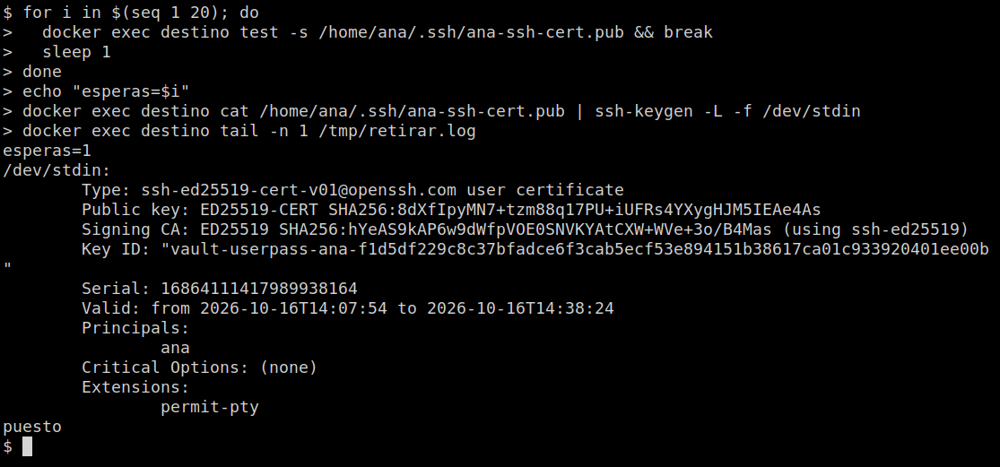
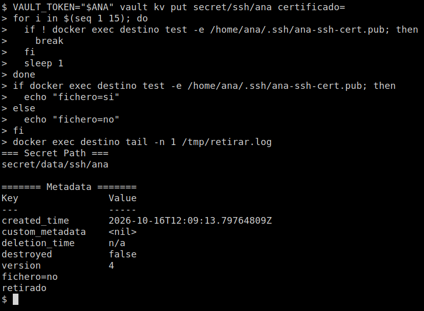

# El certificado llega y se va

[← Página anterior](04-lab-ssh-ca.md) · [Siguiente página →](06-lab-bateria.md)

Vault 1.18 no entra por SSH en el servidor para dejar una clave: ese modo, `key_type=dynamic`, ya no existe. Quien escribe el fichero es Vault Agent, dentro del Ubuntu. Cuando `ana` guarda su certificado en `secret/ssh/ana`, Agent lo deja en `/home/ana/.ssh/ana-ssh-cert.pub`. Cuando el campo queda vacío, Agent borra el fichero.

Ese fichero es la copia en la máquina. `sshd` no lo lee para autorizar. La sesión SSH es el laboratorio anterior: `ssh -p 2222 ana@127.0.0.1`.

### Objetivo

`ssh-keygen -L` muestra un certificado de usuario con principal `ana`. Después de vaciar el secreto, la comprobación escribe `fichero=no`.

### Punto de partida

```bash
bash infra/reiniciar-vault.sh
source infra/entorno.sh
```

Servidor vacío. Hace falta `ssh-keygen` en esta terminal (paquete `openssh-client`). Si no está:

```bash
sudo apt-get update -qq && sudo DEBIAN_FRONTEND=noninteractive apt-get install -y --no-install-recommends openssh-client
```

El contenedor `destino` se crea en esta página. Quítalo al final: el comando está en el último paso.

### En qué consiste

Crear la CA y el rol, guardar el certificado firmado en KV y dejar que Agent, en el Ubuntu, lo escriba y luego lo borre.

### 1 — Habilita el motor y genera la CA

**Acción:**

```bash
vault secrets enable -path=ssh ssh
vault write ssh/config/ca generate_signing_key=true key_type=ed25519
```

**Por qué:** el certificado que Agent va a copiar lo firma esta CA. `key_type=ed25519` es el que usa el laboratorio de la sesión SSH. La privada se queda en Vault.

**Resultado esperado:** `Success! Enabled the ssh secrets engine at: ssh/`. En la ficha, `public_key` empieza por `ssh-ed25519`.

### 2 — Crea el rol de acceso

**Acción:**

```bash
curl -sS -o /dev/null -w "http=%{http_code}\n" \
  --header "X-Vault-Token: ${VAULT_TOKEN}" \
  --request POST \
  --data '{"key_type":"ca","allow_user_certificates":true,"allowed_users":"ana","default_user":"ana","allowed_extensions":"permit-pty","default_extensions":{"permit-pty":""},"ttl":"30m","max_ttl":"30m"}' \
  "${VAULT_ADDR}/v1/ssh/roles/acceso"
```

**Por qué:** el rol `acceso` solo firma el principal `ana`, treinta minutos. El cuerpo va en JSON porque `default_extensions` es un mapa: `vault write` con `clave=valor` lo manda como texto y Vault responde 400. El comando `vault` de este curso, además, no reenvía la entrada estándar al contenedor.

**Resultado esperado:** `http=204`.

### 3 — Quién firma y quién lee

**Acción:**

```bash
bash infra/policy.sh firma-ssh <<'EOF'
path "ssh/sign/acceso" {
  capabilities = ["create", "update"]
}
path "secret/data/ssh/ana" {
  capabilities = ["create", "update", "read"]
}
EOF
bash infra/policy.sh entrega-ssh <<'EOF'
path "secret/data/ssh/ana" {
  capabilities = ["read"]
}
path "secret/metadata/ssh/ana" {
  capabilities = ["read"]
}
EOF
vault auth enable userpass
vault write auth/userpass/users/ana password=ana-lab policies=firma-ssh
vault auth enable approle
vault write auth/approle/role/destino \
  token_policies=entrega-ssh \
  token_ttl=15m \
  token_max_ttl=1h
ROLE_ID=$(vault read -field=role_id auth/approle/role/destino/role-id)
SECRET_ID=$(vault write -f -field=secret_id auth/approle/role/destino/secret-id)
echo "role_id_len=${#ROLE_ID}"
echo "secret_id_len=${#SECRET_ID}"
```

**Por qué:** `ana` entra con UserPass y puede firmar y escribir `secret/ssh/ana`. Agent entra con AppRole y solo puede leer ese secreto. Las dos variables se quedan en esta terminal para el paso 5. No son el certificado.

**Resultado esperado:** `Policy firma-ssh escrita.`, `Policy entrega-ssh escrita.`, el alta de UserPass y de AppRole, `role_id_len=36` y `secret_id_len=36`.

### 4 — El Ubuntu y el binario de Agent

**Acción:**

```bash
docker rm -f destino >/dev/null 2>&1 || true
RED=$(docker inspect -f '{{range $k, $v := .NetworkSettings.Networks}}{{$k}}{{"\n"}}{{end}}' vault-dev | head -n 1)
echo "red=$RED"
docker run -d --name destino --network "$RED" ubuntu:24.04 sleep infinity >/dev/null
docker exec destino useradd -m -s /bin/bash ana
cid=$(docker create hashicorp/vault:1.18)
docker cp "$cid":/bin/vault /tmp/vault-bin
docker rm "$cid" >/dev/null
docker cp /tmp/vault-bin destino:/usr/local/bin/vault
docker exec destino sh -c 'chmod +x /usr/local/bin/vault && /usr/local/bin/vault version'
```

**Por qué:** `destino` es la máquina donde tiene que aparecer el fichero. Comparte la red de `vault-dev`. La imagen Ubuntu no trae el binario `vault`; se copia de `hashicorp/vault:1.18` para ejecutar Agent. `ana` es la cuenta cuyo home va a recibir el certificado. No hace falta `sshd`: este laboratorio no abre la sesión.

**Resultado esperado:** `red=infra_default` y una línea `Vault v1.18.5` (el parche puede variar dentro de 1.18).

### 5 — Agent espera el certificado

**Acción:**

```bash
printf '%s' "$ROLE_ID" | docker exec -i destino tee /tmp/role_id >/dev/null
printf '%s' "$SECRET_ID" | docker exec -i destino tee /tmp/secret_id >/dev/null
docker exec -i destino tee /tmp/retirar.sh >/dev/null <<'EOF'
#!/bin/sh
f=/home/ana/.ssh/ana-ssh-cert.pub
if [ ! -s "$f" ]; then
  rm -f "$f"
  echo "retirado" >> /tmp/retirar.log
else
  echo "puesto" >> /tmp/retirar.log
fi
EOF
docker exec destino chmod +x /tmp/retirar.sh
docker exec -i destino tee /tmp/agent.hcl >/dev/null <<'EOF'
pid_file = "/tmp/vault-agent.pid"

vault {
  address = "http://vault-dev:8200"
}

auto_auth {
  method "approle" {
    config = {
      role_id_file_path = "/tmp/role_id"
      secret_id_file_path = "/tmp/secret_id"
      remove_secret_id_file_after_reading = false
    }
  }
}

template_config {
  static_secret_render_interval = "5s"
}

template {
  destination = "/home/ana/.ssh/ana-ssh-cert.pub"
  create_dest_dirs = true
  perms = "0644"
  contents = "{{ with secret \"secret/data/ssh/ana\" }}{{ .Data.data.certificado }}{{ end }}"
  command = "/tmp/retirar.sh"
}
EOF
docker exec -d destino sh -c '/usr/local/bin/vault agent -config=/tmp/agent.hcl > /tmp/agent.log 2>&1'
sleep 2
if docker exec destino test -e /home/ana/.ssh/ana-ssh-cert.pub; then echo fichero=si; else echo fichero=no; fi
```

**Por qué:** Agent entra solo y lee `secret/ssh/ana` cada cinco segundos. Un KV v2 no tiene lease: sin ese intervalo no volvería a mirar. El secreto todavía no existe, así que no hay fichero. Si más adelante el campo `certificado` llega vacío, `/tmp/retirar.sh` borra el fichero: un render que falla no lo haría, dejaría la copia anterior. En el log puede salir `no secret exists at secret/data/ssh/ana`. Es la espera.

**Resultado esperado:** `fichero=no`.

### 6 — Ana firma y guarda el certificado

**Acción:**

```bash
rm -f /tmp/ana-ssh /tmp/ana-ssh.pub /tmp/ana-ssh-cert.pub
ssh-keygen -t ed25519 -N '' -f /tmp/ana-ssh -C 'ana@lab' -q
curl -sS -o /tmp/ana.json -w "http=%{http_code}\n" --request POST \
  --data '{"password":"ana-lab"}' \
  "${VAULT_ADDR}/v1/auth/userpass/login/ana"
ANA=$(python3 -c 'import json; print(json.load(open("/tmp/ana.json"))["auth"]["client_token"])')
echo "token_len=${#ANA}"
export PUB="$(cat /tmp/ana-ssh.pub)"
curl -sS -o /tmp/ssh-sign.json -w "http=%{http_code}\n" \
  --header "X-Vault-Token: ${ANA}" \
  --request POST \
  --data "$(python3 -c 'import json,os; print(json.dumps({"public_key": os.environ["PUB"], "valid_principals": "ana"}))')" \
  "${VAULT_ADDR}/v1/ssh/sign/acceso"
python3 -c 'import json; d=json.load(open("/tmp/ssh-sign.json")); open("/tmp/ana-ssh-cert.pub","w").write(d["data"]["signed_key"]); print("cert_bytes", len(d["data"]["signed_key"]))'
export CERT="$(cat /tmp/ana-ssh-cert.pub)"
curl -sS -o /dev/null -w "guardado=%{http_code}\n" \
  --header "X-Vault-Token: ${ANA}" \
  --request POST \
  --data "$(python3 -c 'import json,os; print(json.dumps({"data":{"certificado": os.environ["CERT"]}}))')" \
  "${VAULT_ADDR}/v1/secret/data/ssh/ana"
```

**Por qué:** el token que firma y guarda es el de `ana` / `ana-lab`, no el `root`. Vault devuelve el certificado y `ana` lo deja en `secret/ssh/ana`. La privada sigue en `/tmp/ana-ssh`, en esta máquina. Agent todavía no ha copiado nada: el fichero de destino lo escribe él en el paso siguiente.

**Resultado esperado:** el login es `http=200` y `token_len=95`. La firma es `http=200` y `cert_bytes` por encima de 500. La última línea es `guardado=200`.

### 7 — El certificado está en el Ubuntu

**Acción:**

```bash
for i in $(seq 1 20); do
  docker exec destino test -s /home/ana/.ssh/ana-ssh-cert.pub && break
  sleep 1
done
echo "esperas=$i"
docker exec destino cat /home/ana/.ssh/ana-ssh-cert.pub | ssh-keygen -L -f /dev/stdin
docker exec destino tail -n 1 /tmp/retirar.log
```

**Por qué:** Agent ha leído el KV y ha escrito el fichero. Nadie ha hecho `docker cp` del certificado. `ssh-keygen -L` enseña que es un certificado de usuario firmado por la CA, con principal `ana`. La línea `puesto` es el script que corre después de cada render.

**Resultado esperado:** `esperas=` es un entero pequeño. En `ssh-keygen` aparecen `Type: ssh-ed25519-cert-v01@openssh.com user certificate`, `Principals:` con `ana` debajo, y `permit-pty`. La última línea es `puesto`.



### 8 — Vacía el secreto y el fichero desaparece

**Acción:**

```bash
VAULT_TOKEN="$ANA" vault kv put secret/ssh/ana certificado=
for i in $(seq 1 15); do
  if ! docker exec destino test -e /home/ana/.ssh/ana-ssh-cert.pub; then
    break
  fi
  sleep 1
done
if docker exec destino test -e /home/ana/.ssh/ana-ssh-cert.pub; then
  echo "fichero=si"
else
  echo "fichero=no"
fi
docker exec destino tail -n 1 /tmp/retirar.log
```

**Por qué:** borrar el secreto del todo haría fallar el render, y Agent conservaría la copia anterior. Dejar `certificado` vacío sí renderiza: el fichero queda a cero bytes y `/tmp/retirar.sh` lo elimina. El intervalo es de cinco segundos. `VAULT_TOKEN` es el de `ana`: su policy puede escribir ese secreto.

**Resultado esperado:** la ficha del `kv put` muestra `secret/data/ssh/ana` y un `version` nuevo (la primera vez es `2`). Después, `fichero=no` y `retirado`.



### 9 — Quita el servidor

**Acción:**

```bash
docker rm -f destino >/dev/null
```

**Por qué:** para Agent y el Ubuntu. El servidor `vault-dev` sigue.

**Resultado esperado:** termina sin texto.

> [!WARNING]
> Si pasas a otra página sin este paso, `bash infra/reiniciar-vault.sh` también elimina `destino`.

## Comprueba tu entendimiento

**La privada no viajó a destino**

```bash
grep -c "BEGIN OPENSSH PRIVATE KEY" /tmp/ana-ssh
stat -c 'modo=%a' /tmp/ana-ssh
```

→ `1` y `modo=600`. Esa clave sigue en esta máquina. A `destino` solo llegó el certificado, y el paso 8 lo quitó.

## Reto

### 1 — Si el secreto vuelve, el fichero vuelve

Con `destino` todavía en marcha y el certificado en `/tmp/ana-ssh-cert.pub`, vuélvelo a guardar y espera el fichero.

<details>
<summary>Ver solución</summary>

```bash
export CERT="$(cat /tmp/ana-ssh-cert.pub)"
curl -sS -o /dev/null -w "guardado=%{http_code}\n" \
  --header "X-Vault-Token: ${ANA}" \
  --request POST \
  --data "$(python3 -c 'import json,os; print(json.dumps({"data":{"certificado": os.environ["CERT"]}}))')" \
  "${VAULT_ADDR}/v1/secret/data/ssh/ana"
for i in $(seq 1 20); do
  docker exec destino test -s /home/ana/.ssh/ana-ssh-cert.pub && break
  sleep 1
done
if docker exec destino test -s /home/ana/.ssh/ana-ssh-cert.pub; then echo fichero=si; else echo fichero=no; fi
```

`guardado=200` y `fichero=si`. Agent sigue leyendo. Al acabar: `docker rm -f destino`.

</details>

## Errores frecuentes

| Síntoma | Causa probable | Cómo arreglarlo |
|---------|----------------|-----------------|
| `http=400` al crear el rol, con `expected a map` | `default_extensions` se envió como texto | Usa el `curl` del paso 2 |
| `esperas=20` y el fichero no está | Agent no llegó a leer, o `guardado=` no fue 200 | `docker exec destino tail /tmp/agent.log`. Tiene que existir `static_secret_render_interval` y el POST de `secret/data/ssh/ana` |
| `fichero=si` en el paso 8 | El render falló y Agent conservó la copia, o `/tmp/retirar.sh` no es ejecutable | Repite los pasos 5 y 8. El `vault kv put` tiene que dejar `certificado` vacío, no borrar el secreto |
| `permission denied` en el log de Agent | La policy `entrega-ssh` no lee `secret/data/ssh/ana` | Repite el paso 3 y copia otra vez `ROLE_ID` y `SECRET_ID` |
| `vault: command not found` dentro de `destino` | No se copió `/usr/local/bin/vault` | Repite el paso 4 |
| `connection refused` en el log de Agent | `vault.address` es `127.0.0.1` dentro de `destino` | Tiene que ser `http://vault-dev:8200` |
| `dynamic key type roles are no longer supported` | Se intentó `key_type=dynamic` | Este laboratorio no usa ese modo. El rol es el `curl` del paso 2 y quien copia es Agent |
